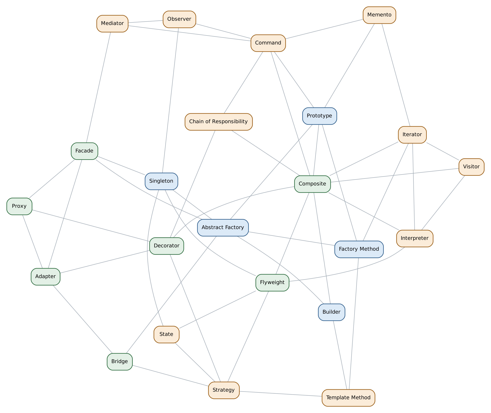

# Catálogo GoF en Java: de la deuda técnica al patrón

[](../../actions/workflows/build.yml)

Repositorio de apoyo a la *Guía de Estudio Avanzado del Catálogo de Patrones de Diseño GoF* (Currículo de Ingeniería de Software 2026-I). Para cada uno de los 23 patrones de Gamma, Helm, Johnson y Vlissides encontrará:

1. **`problema/`**: un diseño realista con deuda técnica que el patrón resuelve, con su diagrama de clases.
2. **`solucion/`**: el mismo caso refactorizado aplicando el patrón, con el diagrama de clases mejorado.
3. **`ejemplos/`**: dos ejemplos adicionales que muestran variantes o usos del patrón en otros dominios.

Todas las demos son ejecutables (`Demo.java` con `main`) y no requieren dependencias externas.

## Requisitos

- JDK 17 o superior (se usan `record`, `sealed` y *switch expressions*).
- Maven 3.9+ (opcional; también puede compilarse solo con `javac`).

## Compilar y ejecutar

```bash
# Con Maven
mvn -q compile
java -cp target/classes edu.ingsoft.gof.comportamiento.observer.solucion.Demo

# Sin Maven (compila con javac y ejecuta demos)
scripts/ejecutar.sh                 # todas las demos
scripts/ejecutar.sh strategy        # demos de un patrón
scripts/ejecutar.sh state.problema  # una demo concreta
```

## Estructura

```text
src/main/java/edu/ingsoft/gof/
├── creacionales/     abstractfactory, builder, factorymethod, prototype, singleton
├── estructurales/    adapter, bridge, composite, decorator, facade, flyweight, proxy
└── comportamiento/   chainofresponsibility, command, interpreter, iterator, mediator,
                      memento, observer, state, strategy, templatemethod, visitor
    └── <patron>/
        ├── README.md     ficha del patrón con diagramas
        ├── problema/     código con deuda técnica + Demo
        ├── solucion/     código refactorizado con el patrón + Demo
        └── ejemplos/     dos ejemplos adicionales (cada uno con su Demo)
docs/diagramas/            fuentes PlantUML (.puml) y PNG de cada diagrama
scripts/ejecutar.sh        compila con javac y ejecuta las demos
```

Convención de colores en los diagramas: **azul** = estructura genérica del patrón, **rojo** = diseño con deuda técnica, **verde** = diseño refactorizado.

## Patrones creacionales

| # | Patrón | Nombre en español | Ámbito | Intención |
|---|---|---|---|---|
| 1 | [Abstract Factory](src/main/java/edu/ingsoft/gof/creacionales/abstractfactory/) | Fábrica Abstracta | Objeto | Proporcionar una interfaz para crear familias de objetos relacionados o dependientes sin especificar sus clases concretas. |
| 2 | [Builder](src/main/java/edu/ingsoft/gof/creacionales/builder/) | Constructor | Objeto | Separar la construcción de un objeto complejo de su representación, de modo que el mismo proceso de construcción pueda crear representaciones diferentes. |
| 3 | [Factory Method](src/main/java/edu/ingsoft/gof/creacionales/factorymethod/) | Método Fábrica | Clase | Definir una interfaz para crear un objeto, pero dejar que sean las subclases quienes decidan qué clase instanciar. Permite que una clase delegue en sus subclases la creación de objetos. |
| 4 | [Prototype](src/main/java/edu/ingsoft/gof/creacionales/prototype/) | Prototipo | Objeto | Especificar los tipos de objetos a crear por medio de una instancia prototípica, y crear nuevos objetos copiando dicho prototipo. |
| 5 | [Singleton](src/main/java/edu/ingsoft/gof/creacionales/singleton/) | Instancia Única | Objeto | Garantizar que una clase tenga una única instancia y proporcionar un punto de acceso global a ella. |

## Patrones estructurales

| # | Patrón | Nombre en español | Ámbito | Intención |
|---|---|---|---|---|
| 6 | [Adapter](src/main/java/edu/ingsoft/gof/estructurales/adapter/) | Adaptador | Clase y objeto | Convertir la interfaz de una clase en otra interfaz que esperan los clientes. Permite que colaboren clases que de otro modo no podrían hacerlo por tener interfaces incompatibles. |
| 7 | [Bridge](src/main/java/edu/ingsoft/gof/estructurales/bridge/) | Puente | Objeto | Desacoplar una abstracción de su implementación, de modo que ambas puedan variar de forma independiente. |
| 8 | [Composite](src/main/java/edu/ingsoft/gof/estructurales/composite/) | Compuesto | Objeto | Componer objetos en estructuras de árbol para representar jerarquías parte-todo. Permite que los clientes traten de manera uniforme a los objetos individuales y a las composiciones. |
| 9 | [Decorator](src/main/java/edu/ingsoft/gof/estructurales/decorator/) | Decorador | Objeto | Asignar responsabilidades adicionales a un objeto dinámicamente. Los decoradores ofrecen una alternativa flexible a la herencia para extender la funcionalidad. |
| 10 | [Facade](src/main/java/edu/ingsoft/gof/estructurales/facade/) | Fachada | Objeto | Proporcionar una interfaz unificada para un conjunto de interfaces de un subsistema. Define una interfaz de alto nivel que hace que el subsistema sea más fácil de usar. |
| 11 | [Flyweight](src/main/java/edu/ingsoft/gof/estructurales/flyweight/) | Peso Ligero | Objeto | Usar un compartimiento para permitir un gran número de objetos de grano fino de forma eficiente. |
| 12 | [Proxy](src/main/java/edu/ingsoft/gof/estructurales/proxy/) | Apoderado | Objeto | Proporcionar un sustituto o representante de otro objeto para controlar el acceso a él. |

## Patrones de comportamiento

| # | Patrón | Nombre en español | Ámbito | Intención |
|---|---|---|---|---|
| 13 | [Chain of Responsibility](src/main/java/edu/ingsoft/gof/comportamiento/chainofresponsibility/) | Cadena de Responsabilidad | Objeto | Evitar acoplar el emisor de una petición a su receptor, dando a más de un objeto la posibilidad de responder a la petición. Encadena los objetos receptores y pasa la petición a lo largo de la cadena hasta que un objeto la maneje. |
| 14 | [Command](src/main/java/edu/ingsoft/gof/comportamiento/command/) | Orden | Objeto | Encapsular una petición como un objeto, permitiendo parametrizar a los clientes con diferentes peticiones, encolar o registrar peticiones y soportar operaciones que pueden deshacerse. |
| 15 | [Interpreter](src/main/java/edu/ingsoft/gof/comportamiento/interpreter/) | Intérprete | Clase | Dado un lenguaje, definir una representación de su gramática junto con un intérprete que usa dicha representación para interpretar sentencias del lenguaje. |
| 16 | [Iterator](src/main/java/edu/ingsoft/gof/comportamiento/iterator/) | Iterador | Objeto | Proporcionar un modo de acceder secuencialmente a los elementos de un objeto agregado sin exponer su representación interna. |
| 17 | [Mediator](src/main/java/edu/ingsoft/gof/comportamiento/mediator/) | Mediador | Objeto | Definir un objeto que encapsule cómo interactúa un conjunto de objetos. Promueve un acoplamiento débil al evitar que los objetos se refieran unos a otros explícitamente y permite variar sus interacciones de forma independiente. |
| 18 | [Memento](src/main/java/edu/ingsoft/gof/comportamiento/memento/) | Recuerdo | Objeto | Sin violar el encapsulamiento, capturar y externalizar el estado interno de un objeto de modo que este pueda restaurarse más tarde a dicho estado. |
| 19 | [Observer](src/main/java/edu/ingsoft/gof/comportamiento/observer/) | Observador | Objeto | Definir una dependencia de uno a muchos entre objetos, de forma que cuando un objeto cambie de estado se notifique y se actualicen automáticamente todos los objetos que dependen de él. |
| 20 | [State](src/main/java/edu/ingsoft/gof/comportamiento/state/) | Estado | Objeto | Permitir que un objeto altere su comportamiento cuando cambia su estado interno. Parecerá que el objeto cambia de clase. |
| 21 | [Strategy](src/main/java/edu/ingsoft/gof/comportamiento/strategy/) | Estrategia | Objeto | Definir una familia de algoritmos, encapsular cada uno de ellos y hacerlos intercambiables. Permite que el algoritmo varíe independientemente de los clientes que lo usan. |
| 22 | [Template Method](src/main/java/edu/ingsoft/gof/comportamiento/templatemethod/) | Método Plantilla | Clase | Definir en una operación el esqueleto de un algoritmo, delegando en las subclases algunos de sus pasos. Permite que las subclases redefinan ciertos pasos de un algoritmo sin cambiar su estructura. |
| 23 | [Visitor](src/main/java/edu/ingsoft/gof/comportamiento/visitor/) | Visitante | Objeto | Representar una operación que debe realizarse sobre los elementos de una estructura de objetos. Permite definir una nueva operación sin cambiar las clases de los elementos sobre los que opera. |

## Mapa de relaciones entre patrones



## Regenerar los diagramas

Los diagramas se escribieron en PlantUML. Para regenerarlos:

```bash
java -jar plantuml.jar -tpng -charset UTF-8 docs/diagramas/**/*.puml
```

## Bibliografía

- Gamma, E., Helm, R., Johnson, R. y Vlissides, J. (1994). *Design Patterns: Elements of Reusable Object-Oriented Software*. Addison-Wesley.
- Bloch, J. (2018). *Effective Java* (3.ª ed.). Addison-Wesley.
- Fowler, M. (2018). *Refactoring: Improving the Design of Existing Code* (2.ª ed.). Addison-Wesley.
- Kerievsky, J. (2004). *Refactoring to Patterns*. Addison-Wesley.
- Freeman, E. y Robson, E. (2020). *Head First Design Patterns* (2.ª ed.). O'Reilly.
