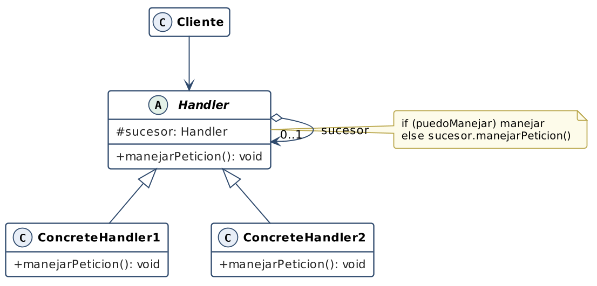
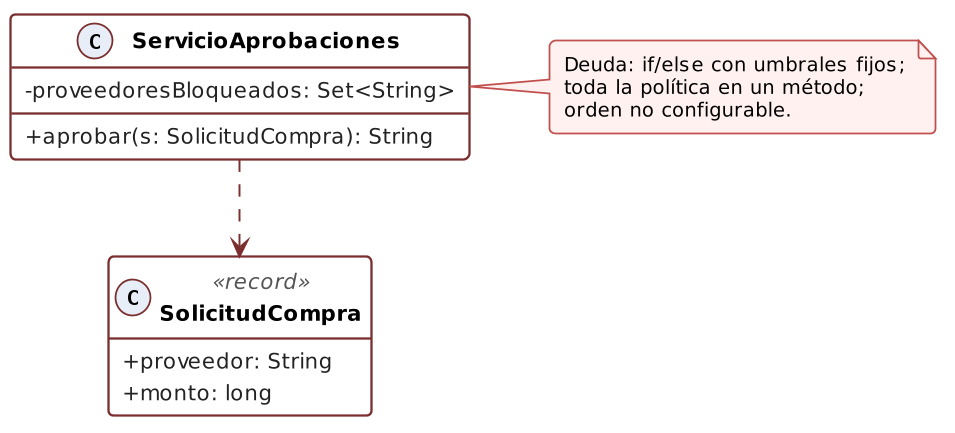
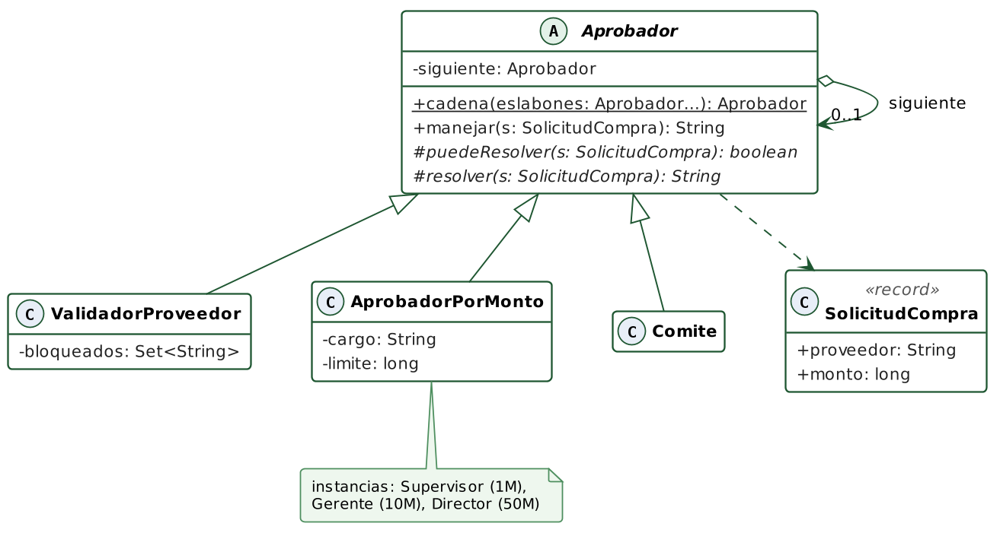

# 13. Chain of Responsibility (Cadena de Responsabilidad)

**Categoría:** Comportamiento · **Ámbito:** Objeto · **También conocido como:** Cadena de responsabilidad

> **Intención.** Evitar acoplar el emisor de una petición a su receptor, dando a más de un objeto la posibilidad de responder a la petición. Encadena los objetos receptores y pasa la petición a lo largo de la cadena hasta que un objeto la maneje.

## Estructura genérica



## 1. Problema: código con deuda técnica (`problema/`)

ServicioAprobaciones contiene la política completa en una cadena de if/else, incluidas la validación del proveedor y los umbrales fijos.



**Deuda técnica identificada:**

- Condicional largo con números mágicos (umbrales fijos en el código).
- Todas las reglas en una clase: cualquier cambio de política la modifica (viola SRP y OCP).
- El orden de evaluación está implícito en el código y es imposible reconfigurarlo en ejecución.
- Las reglas no pueden probarse ni reutilizarse por separado.

## 2. Solución refactorizada con el patrón (`solucion/`)

La clase abstracta Aprobador define el enlace al sucesor y un método plantilla manejar(). Cada nivel de aprobación es un eslabón con su umbral configurable; ValidadorProveedor puede detener la cadena. El cliente arma la cadena de forma explícita con Aprobador.cadena(...).



## 3. Ejemplos adicionales (`ejemplos/`)

| Paquete | Ejemplo | Descripción |
|---|---|---|
| `ejemplos/middleware` | Middleware HTTP (pipeline) | Autenticación, límite de peticiones y registro como eslabones que pueden detener la petición. |
| `ejemplos/soporte` | Mesa de soporte por niveles | Bot, nivel 1 y especialista escalan tickets según su complejidad. |

## Cómo ejecutar

```bash
scripts/ejecutar.sh chainofresponsibility            # todas las demos de este patrón
java -cp target/classes edu.ingsoft.gof.comportamiento.chainofresponsibility.problema.Demo
java -cp target/classes edu.ingsoft.gof.comportamiento.chainofresponsibility.solucion.Demo
```

## Salida esperada de la solución

```text
       500,000 -> Aprobada por Supervisor
     7,000,000 -> Aprobada por Gerente
    30,000,000 -> Aprobada por Director
    75,000,000 -> Aprobada por Vicepresidente
    90,000,000 -> Enviada a Comité
Rechazada: proveedor bloqueado
```

## Preguntas de estudio

1. ¿Qué ocurre si ningún eslabón maneja la petición? Proponga dos estrategias para evitarlo.
2. Compare Chain of Responsibility con una lista de Strategy evaluadas en orden.
3. ¿Cómo cargaría la configuración de la cadena (orden y umbrales) desde un archivo?

[← Volver al índice](../../../../../../../../README.md)
