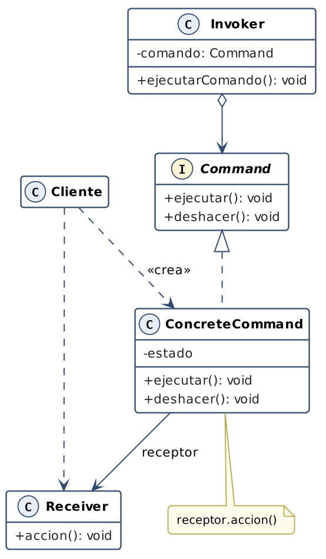
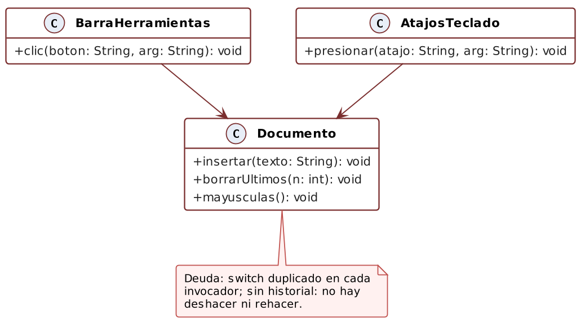
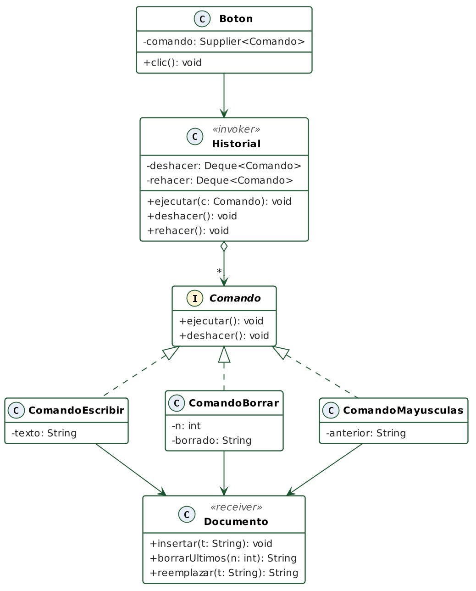

# 14. Command (Orden)

**Categoría:** Comportamiento · **Ámbito:** Objeto · **También conocido como:** Action, Transaction, Acción, Transacción

> **Intención.** Encapsular una petición como un objeto, permitiendo parametrizar a los clientes con diferentes peticiones, encolar o registrar peticiones y soportar operaciones que pueden deshacerse.

## Estructura genérica



## 1. Problema: código con deuda técnica (`problema/`)

BarraHerramientas y AtajosTeclado contienen cada uno un switch que invoca al Documento. No existe historial, por lo que deshacer es imposible.



**Deuda técnica identificada:**

- Switch duplicado en cada invocador (barra, atajos, menú).
- Invocadores acoplados al receptor (Documento) y a los detalles de cada operación.
- Sin representación de la petición: no se puede deshacer, rehacer, registrar ni encolar.
- Agregar una acción obliga a modificar todos los invocadores.

## 2. Solución refactorizada con el patrón (`solucion/`)

Comando declara ejecutar() y deshacer(). Cada acción es un comando que guarda lo necesario para revertirse. Historial actúa como invocador con pilas de deshacer y rehacer. Botones y atajos se configuran con instancias de comando en lugar de contener switches.



## 3. Ejemplos adicionales (`ejemplos/`)

| Paquete | Ejemplo | Descripción |
|---|---|---|
| `ejemplos/domotica` | Control domótico con macros | Comandos para luces y termostato; una macro «modo noche» que se deshace en orden inverso. |
| `ejemplos/cola` | Cola de trabajos con reintentos | Comandos encolados que se ejecutan en segundo plano y se reintentan si fallan. |

## Cómo ejecutar

```bash
scripts/ejecutar.sh command            # todas las demos de este patrón
java -cp target/classes edu.ingsoft.gof.comportamiento.command.problema.Demo
java -cp target/classes edu.ingsoft.gof.comportamiento.command.solucion.Demo
```

## Salida esperada de la solución

```text
Tras ejecutar:   HOLA MUNDO
Deshacer:        Hola mundo
Borrar 5:        Hola 
Deshacer:        Hola mundo
Rehacer:         Hola 
```

## Preguntas de estudio

1. ¿Por qué ejecutar un comando nuevo debe vaciar la pila de rehacer?
2. Diseñe un MacroComando. ¿En qué orden deben deshacerse sus subcomandos y por qué?
3. ¿Cuándo basta una lambda Runnable y cuándo se necesita una clase Command completa?

[← Volver al índice](../../../../../../../../README.md)
