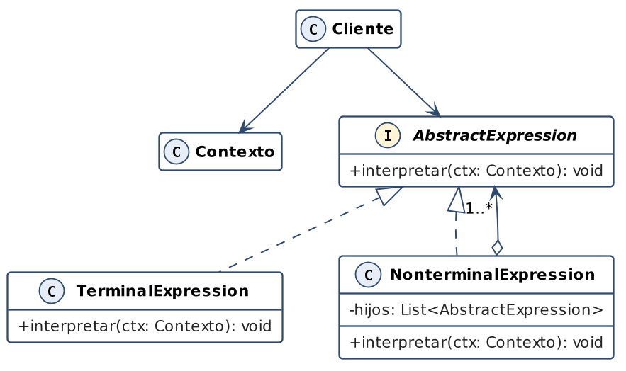
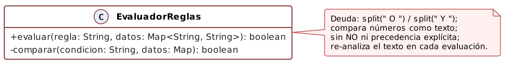
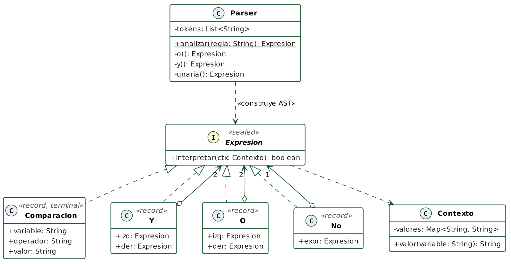

# 15. Interpreter (Intérprete)

**Categoría:** Comportamiento · **Ámbito:** Clase · **También conocido como:** Intérprete

> **Intención.** Dado un lenguaje, definir una representación de su gramática junto con un intérprete que usa dicha representación para interpretar sentencias del lenguaje.

## Estructura genérica



## 1. Problema: código con deuda técnica (`problema/`)

EvaluadorReglas divide el texto con split(" O ") y split(" Y ") y compara valores con condicionales anidados. No soporta NO ni paréntesis y compara números como texto.



**Deuda técnica identificada:**

- Lógica de análisis y de evaluación mezcladas en un solo método con manipulación de cadenas.
- Gramática implícita: no hay una representación de la regla; se reinterpreta el texto cada vez.
- Comparaciones numéricas hechas como texto ("9" > "18" es verdadero).
- Agregar un operador (NO, <=) obliga a reescribir el método.

## 2. Solución refactorizada con el patrón (`solucion/`)

La regla se representa como un AST: Comparacion es la expresión terminal; Y, O y No son no terminales. Un pequeño parser descendente recursivo construye el árbol respetando la precedencia (NO > Y > O). La regla se analiza una sola vez y se evalúa contra distintos contextos.



## 3. Ejemplos adicionales (`ejemplos/`)

| Paquete | Ejemplo | Descripción |
|---|---|---|
| `ejemplos/aritmetica` | Expresiones aritméticas con variables | AST de suma, resta, multiplicación y variables con evaluación e impresión. |
| `ejemplos/romanos` | Números romanos | Intérprete clásico que convierte números romanos a enteros con expresiones por posición. |

## Cómo ejecutar

```bash
scripts/ejecutar.sh interpreter            # todas las demos de este patrón
java -cp target/classes edu.ingsoft.gof.comportamiento.interpreter.problema.Demo
java -cp target/classes edu.ingsoft.gof.comportamiento.interpreter.solucion.Demo
```

## Salida esperada de la solución

```text
AST: ((edad >= 18 Y pais == CO) O vip == si)
edad=25,CO -> true
edad=9,CO  -> false
NO/paréntesis -> true
```

## Preguntas de estudio

1. Escriba la gramática BNF de las reglas del ejemplo y relacione cada producción con una clase.
2. ¿Por qué el parser no forma parte del patrón Interpreter? ¿Qué patrón ayudaría a construir el AST?
3. ¿Cómo agregaría una operación «explicar regla» sin modificar las clases del AST?

[← Volver al índice](../../../../../../../../README.md)
