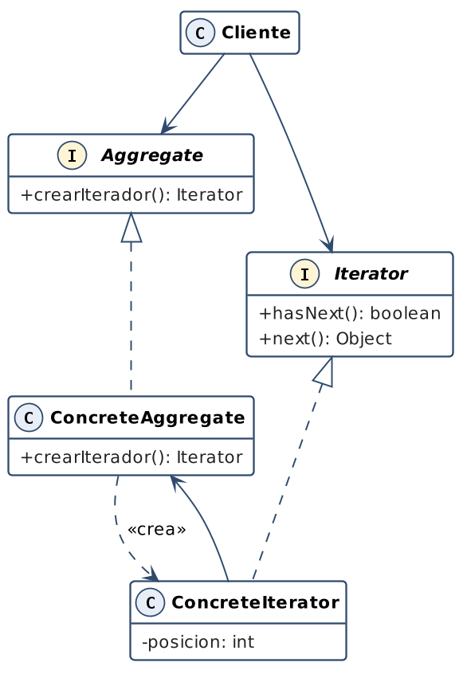
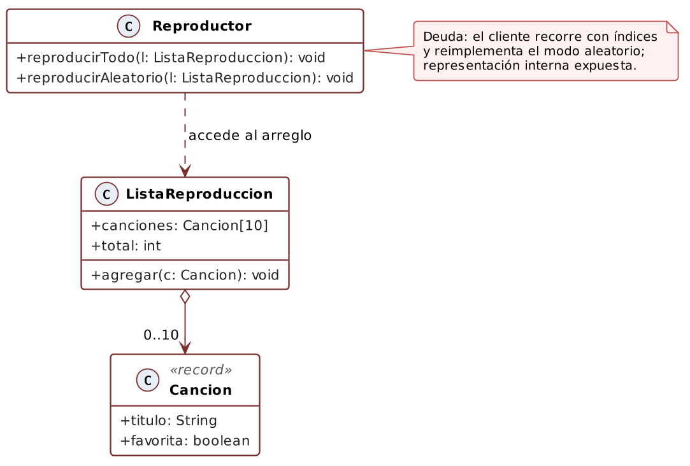
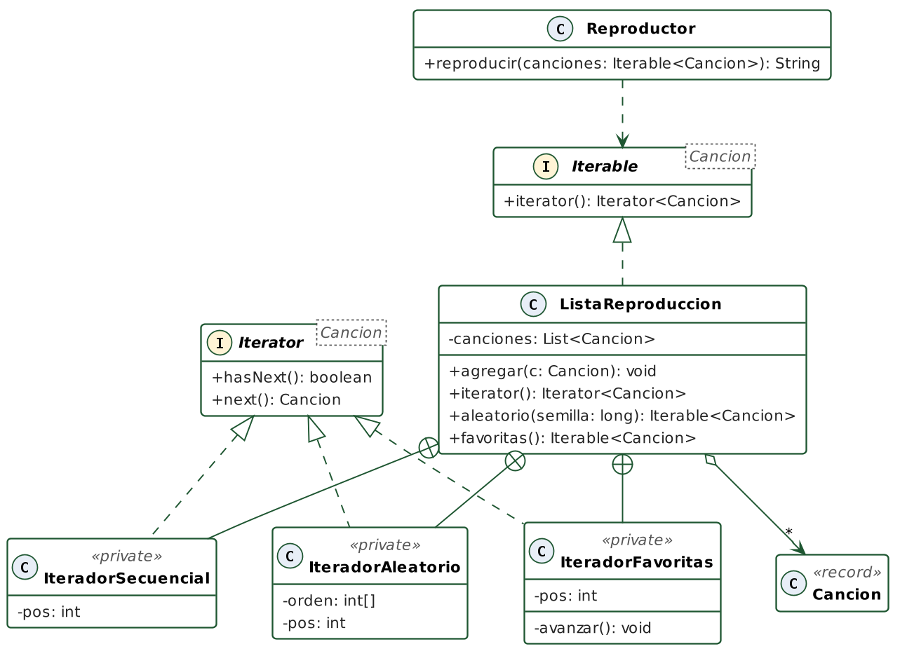

# 16. Iterator (Iterador)

**Categoría:** Comportamiento · **Ámbito:** Objeto · **También conocido como:** Cursor

> **Intención.** Proporcionar un modo de acceder secuencialmente a los elementos de un objeto agregado sin exponer su representación interna.

## Estructura genérica



## 1. Problema: código con deuda técnica (`problema/`)

ListaReproduccion expone un arreglo público de tamaño fijo y un contador. Los clientes recorren con índices e implementan ellos mismos el modo aleatorio.



**Deuda técnica identificada:**

- Exposición de la representación interna (arreglo público y contador): viola el encapsulamiento.
- Los clientes duplican la lógica de recorrido (secuencial, aleatorio) y pueden leer posiciones vacías.
- Cambiar el arreglo por una lista dinámica rompe a todos los clientes.
- Capacidad fija: el arreglo se desborda al superar 10 canciones (ArrayIndexOutOfBoundsException).

## 2. Solución refactorizada con el patrón (`solucion/`)

ListaReproduccion implementa Iterable<Cancion> y encapsula una lista privada. Ofrece iterator() (secuencial), aleatorio(semilla) y favoritas(). Cada recorrido es una clase iteradora privada. Los clientes usan for-each sin conocer la representación.



## 3. Ejemplos adicionales (`ejemplos/`)

| Paquete | Ejemplo | Descripción |
|---|---|---|
| `ejemplos/arbol` | Iterador en orden para un árbol binario | Recorrido inorden iterativo con una pila explícita. |
| `ejemplos/failfast` | Colección propia con iterador fail-fast | Detecta modificaciones durante la iteración usando un contador de modificaciones. |

## Cómo ejecutar

```bash
scripts/ejecutar.sh iterator            # todas las demos de este patrón
java -cp target/classes edu.ingsoft.gof.comportamiento.iterator.problema.Demo
java -cp target/classes edu.ingsoft.gof.comportamiento.iterator.solucion.Demo
```

## Salida esperada de la solución

```text
Favoritas: Matilde Lina | Oye mujer
Aleatorio: Oye mujer | Extra 9 | Extra 1 | Extra 4 | Extra 0 | Extra 2 ...
Total recorrido con for-each: 14
```

## Preguntas de estudio

1. ¿Cómo funciona la estrategia fail-fast de ArrayList y por qué no garantiza detectar todas las modificaciones concurrentes?
2. Compare un iterador externo con un iterador interno (forEach). ¿Cuál permite detener el recorrido con más facilidad?
3. Implemente un iterador perezoso para una secuencia infinita (por ejemplo, Fibonacci).

[← Volver al índice](../../../../../../../../README.md)
