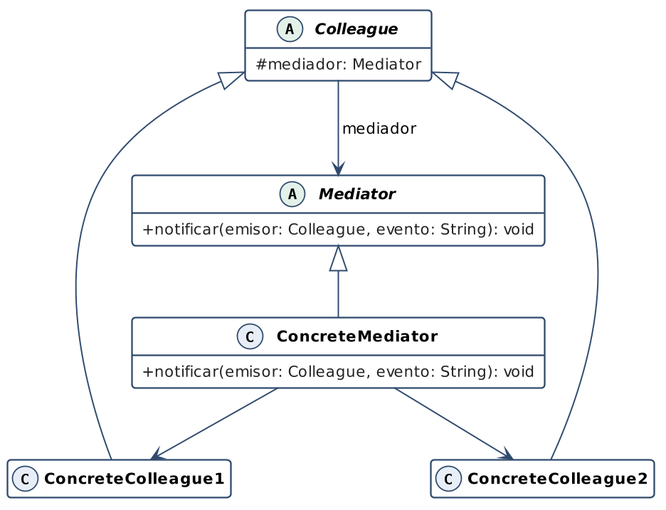
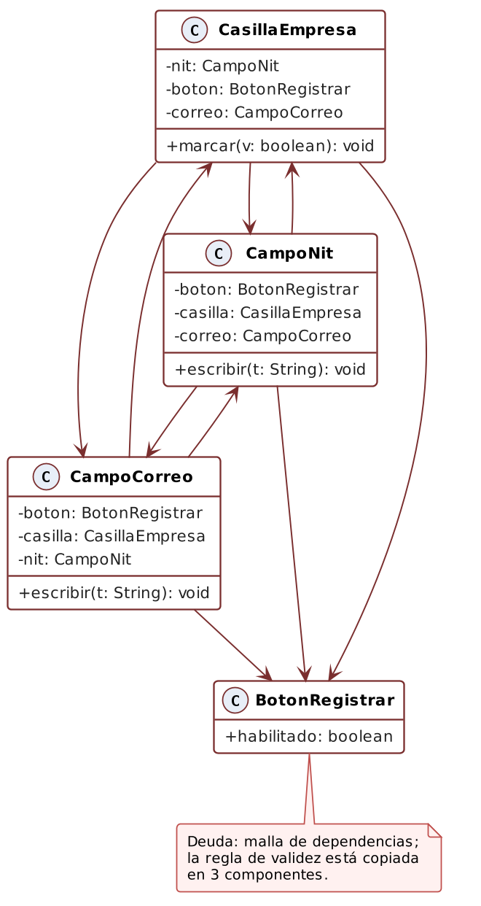
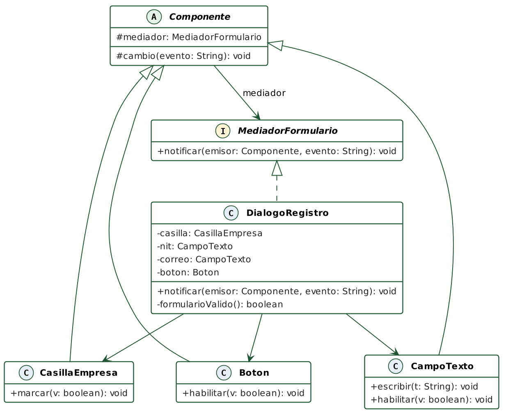

# 17. Mediator (Mediador)

**Categoría:** Comportamiento · **Ámbito:** Objeto · **También conocido como:** Mediador, Intermediario

> **Intención.** Definir un objeto que encapsule cómo interactúa un conjunto de objetos. Promueve un acoplamiento débil al evitar que los objetos se refieran unos a otros explícitamente y permite variar sus interacciones de forma independiente.

## Estructura genérica



## 1. Problema: código con deuda técnica (`problema/`)

CasillaEmpresa, CampoNit, CampoCorreo y BotonRegistrar se referencian directamente. Cada uno recalcula la validez del formulario con su propia copia de la regla.



**Deuda técnica identificada:**

- Acoplamiento en malla: cada componente conoce a varios otros (dependencias cruzadas).
- La regla de validación del formulario está duplicada en varios componentes.
- Los componentes no son reutilizables fuera de este formulario.
- Agregar un campo (teléfono) obliga a modificar varios componentes.

## 2. Solución refactorizada con el patrón (`solucion/`)

Los componentes heredan de Componente y solo conocen a MediadorFormulario: cuando cambian, lo notifican. DialogoRegistro concentra la política (habilitar NIT, validar y habilitar el botón). Los componentes no se conocen entre sí y pueden reutilizarse.



## 3. Ejemplos adicionales (`ejemplos/`)

| Paquete | Ejemplo | Descripción |
|---|---|---|
| `ejemplos/chat` | Sala de chat | Los usuarios envían mensajes a la sala, que los distribuye y gestiona mensajes privados. |
| `ejemplos/torre` | Torre de control aérea | Los aviones solicitan pista a la torre en lugar de coordinarse entre ellos. |

## Cómo ejecutar

```bash
scripts/ejecutar.sh mediator            # todas las demos de este patrón
java -cp target/classes edu.ingsoft.gof.comportamiento.mediator.problema.Demo
java -cp target/classes edu.ingsoft.gof.comportamiento.mediator.solucion.Demo
```

## Salida esperada de la solución

```text
Persona natural -> botón: true
Empresa sin NIT -> botón: false | NIT habilitado: true
Empresa con NIT -> botón: true
```

## Preguntas de estudio

1. Compare las dependencias de 6 componentes en malla frente a un mediador. ¿Cuántas relaciones hay en cada caso?
2. ¿Cómo evitaría que el mediador se convierta en un objeto dios?
3. ¿Qué diferencia hay entre Mediator y un bus de eventos publicador/suscriptor?

[← Volver al índice](../../../../../../../../README.md)
