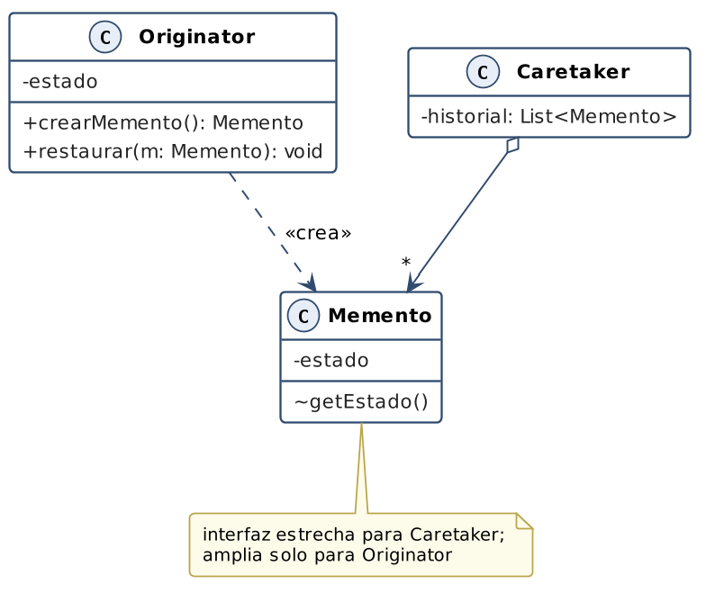
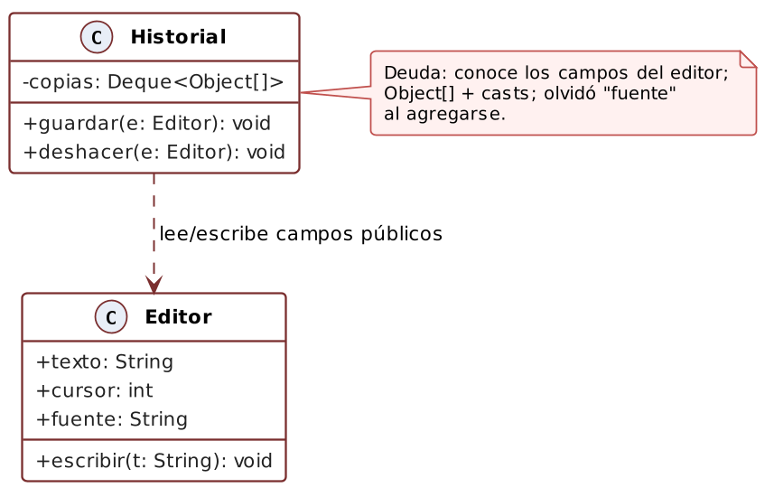
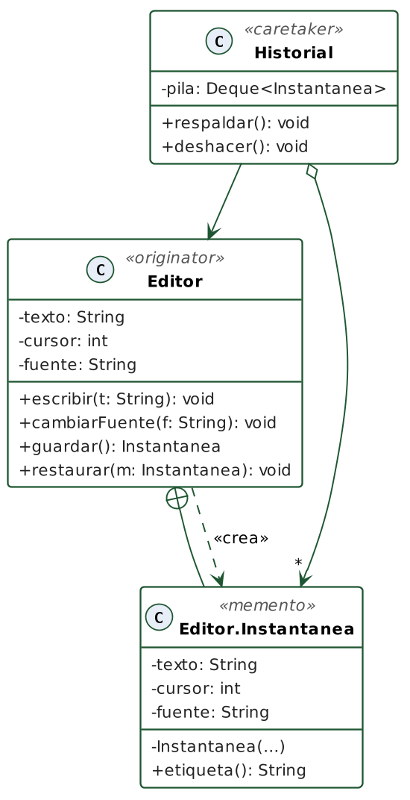

# 18. Memento (Recuerdo)

**Categoría:** Comportamiento · **Ámbito:** Objeto · **También conocido como:** Token, Instantánea, Snapshot

> **Intención.** Sin violar el encapsulamiento, capturar y externalizar el estado interno de un objeto de modo que este pueda restaurarse más tarde a dicho estado.

## Estructura genérica



## 1. Problema: código con deuda técnica (`problema/`)

El editor expone sus campos como públicos y el historial guarda copias manuales en un arreglo de Object. Cuando se agregó el campo fuente, nadie actualizó el historial.



**Deuda técnica identificada:**

- Violación del encapsulamiento: el estado interno del editor es público.
- El cuidador (historial) conoce la estructura interna del originador.
- Fragilidad: agregar un atributo (fuente) no se refleja en las instantáneas y la restauración queda incompleta.
- Uso de Object[] y casts: sin seguridad de tipos.

## 2. Solución refactorizada con el patrón (`solucion/`)

Editor (originador) crea instancias de Editor.Instantanea, una clase anidada inmutable con constructor privado: solo el editor puede leer su contenido. Historial (cuidador) guarda instantáneas en una pila sin conocer su estructura. Agregar un atributo solo afecta al editor.



## 3. Ejemplos adicionales (`ejemplos/`)

| Paquete | Ejemplo | Descripción |
|---|---|---|
| `ejemplos/juego` | Puntos de control en un videojuego | Se guarda la partida antes de un jefe y se restaura al perder. |
| `ejemplos/borrador` | Borrador de formulario con historial acotado | El cuidador conserva solo las últimas N instantáneas del formulario. |

## Cómo ejecutar

```bash
scripts/ejecutar.sh memento            # todas las demos de este patrón
java -cp target/classes edu.ingsoft.gof.comportamiento.memento.problema.Demo
java -cp target/classes edu.ingsoft.gof.comportamiento.memento.solucion.Demo
```

## Salida esperada de la solución

```text
Actual:   'Patrones GoF' cursor=12 fuente=Courier
  restaurando instantánea de 9 caracteres
Deshacer: 'Patrones ' cursor=9 fuente=Arial   <- estado completo restaurado
```

## Preguntas de estudio

1. ¿Cómo se logran en Java las «interfaces amplia y estrecha» del memento?
2. Compare deshacer con Memento frente a deshacer con Command y operaciones inversas.
3. ¿Qué estrategia usaría para limitar la memoria del historial en un editor de imágenes?

[← Volver al índice](../../../../../../../../README.md)
