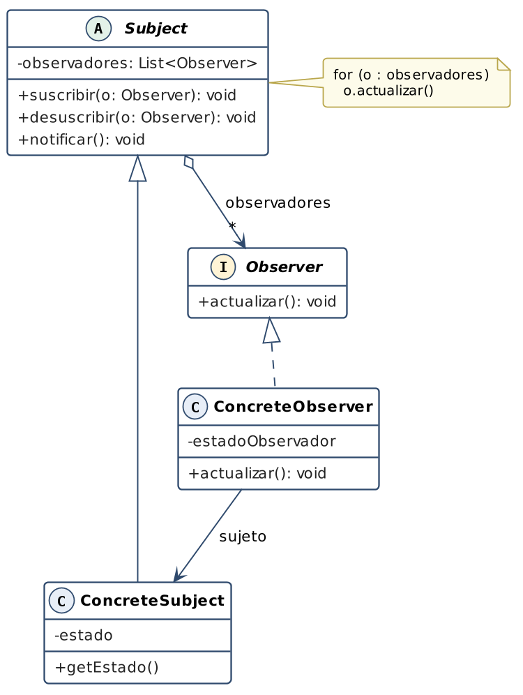
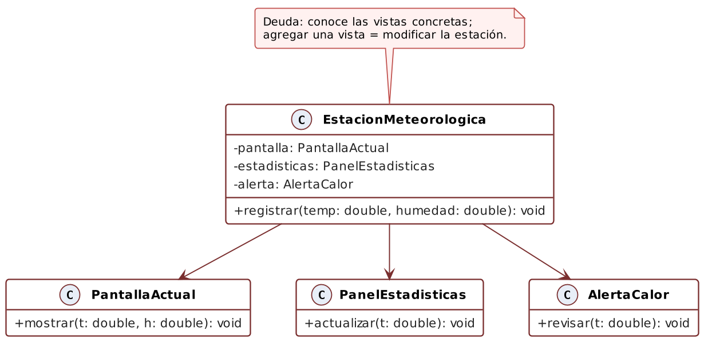
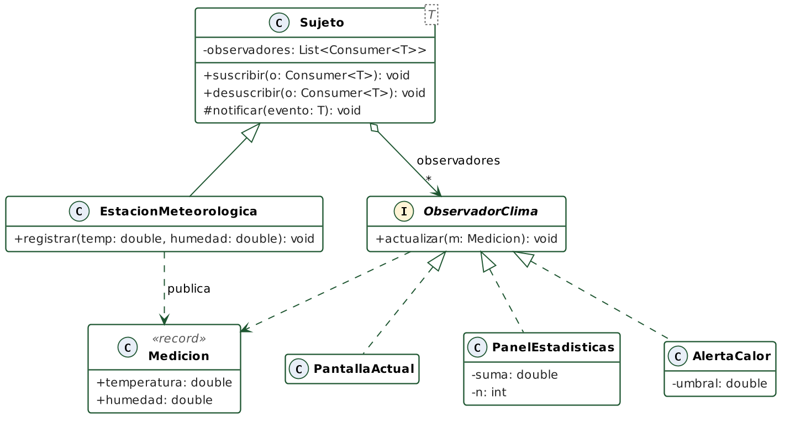

# 19. Observer (Observador)

**Categoría:** Comportamiento · **Ámbito:** Objeto · **También conocido como:** Dependents, Publish-Subscribe, Publicar-Suscribir

> **Intención.** Definir una dependencia de uno a muchos entre objetos, de forma que cuando un objeto cambie de estado se notifique y se actualicen automáticamente todos los objetos que dependen de él.

## Estructura genérica



## 1. Problema: código con deuda técnica (`problema/`)

EstacionMeteorologica tiene referencias a las tres vistas concretas y llama a un método distinto de cada una al registrar una medición.



**Deuda técnica identificada:**

- Acoplamiento del sujeto a clases concretas de vistas (viola DIP).
- Agregar una vista (por ejemplo, un registro en la nube) obliga a modificar la estación (viola OCP).
- Las vistas no pueden suscribirse ni desuscribirse en tiempo de ejecución.
- Interfaces heterogéneas: mostrar(), actualizar() y revisar() hacen lo mismo con nombres distintos.

## 2. Solución refactorizada con el patrón (`solucion/`)

Sujeto<T> es una clase genérica reutilizable que gestiona la lista de observadores. EstacionMeteorologica solo publica una Medicion (record inmutable, modelo push). Las vistas implementan ObservadorClima y se suscriben o desuscriben en tiempo de ejecución.



## 3. Ejemplos adicionales (`ejemplos/`)

| Paquete | Ejemplo | Descripción |
|---|---|---|
| `ejemplos/propertychange` | Observer con PropertyChangeSupport | Un modelo de producto notifica cambios de precio a escuchas JavaBeans. |
| `ejemplos/bus` | Bus de eventos tipado | Publicador/suscriptor genérico por tipo de evento con desuscripción mediante AutoCloseable. |

## Cómo ejecutar

```bash
scripts/ejecutar.sh observer            # todas las demos de este patrón
java -cp target/classes edu.ingsoft.gof.comportamiento.observer.problema.Demo
java -cp target/classes edu.ingsoft.gof.comportamiento.observer.solucion.Demo
```

## Salida esperada de la solución

```text
Medición: 28.5
  Pantalla: 28.5 °C, 70% humedad
  Estadísticas: promedio 28.5 °C
  Nube <- Medicion[temperatura=28.5, humedad=70.0]
Medición: 33.0
  Estadísticas: promedio 30.8 °C
  ALERTA: calor extremo
```

## Preguntas de estudio

1. Compare los modelos push y pull. ¿Cuál acopla más al observador con el sujeto?
2. ¿Qué es el problema del «lapsed listener» y cómo se previene en Java?
3. ¿Por qué se deprecó java.util.Observable y qué alternativas existen?

[← Volver al índice](../../../../../../../../README.md)
