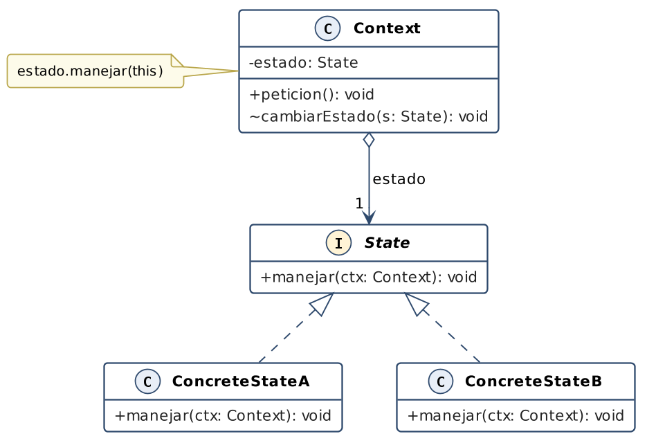
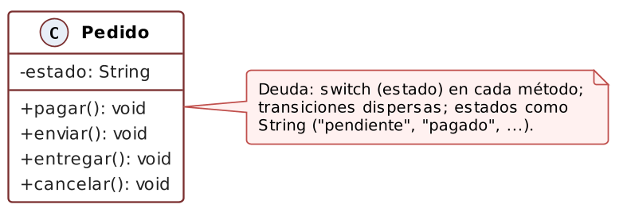
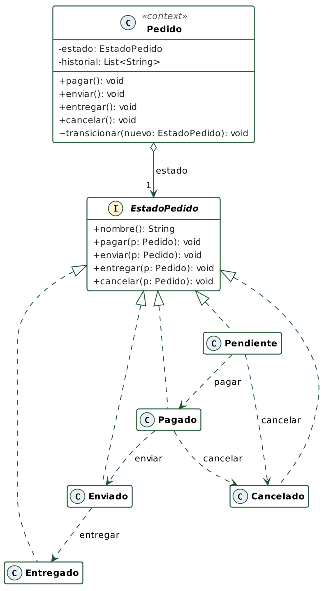

# 20. State (Estado)

**Categoría:** Comportamiento · **Ámbito:** Objeto · **También conocido como:** Objects for States, Objetos para estados

> **Intención.** Permitir que un objeto altere su comportamiento cuando cambia su estado interno. Parecerá que el objeto cambia de clase.

## Estructura genérica



## 1. Problema: código con deuda técnica (`problema/`)

Pedido guarda su estado como String y cada operación (pagar, enviar, entregar, cancelar) contiene un switch con las reglas de transición.



**Deuda técnica identificada:**

- Switch sobre el estado repetido en cada operación (máquina de estados implícita).
- Reglas de transición dispersas: entender qué ocurre en Enviado exige leer todos los métodos.
- Estados inválidos posibles por errores tipográficos en el String.
- Agregar un estado obliga a modificar todos los métodos de Pedido (viola OCP).

## 2. Solución refactorizada con el patrón (`solucion/`)

EstadoPedido declara las operaciones con una implementación por defecto que rechaza la transición. Cada estado concreto sobrescribe solo las operaciones válidas y decide el siguiente estado. Pedido delega en su estado actual; agregar Devuelto sería crear una clase.



## 3. Ejemplos adicionales (`ejemplos/`)

| Paquete | Ejemplo | Descripción |
|---|---|---|
| `ejemplos/expendedora` | Máquina expendedora | Estados SinMoneda, ConMoneda y Agotada con transiciones dependientes del inventario. |
| `ejemplos/semaforo` | Semáforo con enum | Variante compacta en la que cada constante del enum es un estado con su comportamiento. |

## Cómo ejecutar

```bash
scripts/ejecutar.sh state            # todas las demos de este patrón
java -cp target/classes edu.ingsoft.gof.comportamiento.state.problema.Demo
java -cp target/classes edu.ingsoft.gof.comportamiento.state.solucion.Demo
```

## Salida esperada de la solución

```text
  No se puede enviar en estado PENDIENTE
  No se puede cancelar en estado ENVIADO
Estado final: ENTREGADO | historial: [PENDIENTE, PAGADO, ENVIADO, ENTREGADO]
```

## Preguntas de estudio

1. Dibuje el diagrama de máquina de estados del pedido e identifique las transiciones no permitidas.
2. ¿Quién debe decidir la transición, el contexto o el estado? Exponga ventajas y desventajas.
3. ¿Cuándo es preferible un enum con comportamiento en lugar de una jerarquía de clases de estado?

[← Volver al índice](../../../../../../../../README.md)
