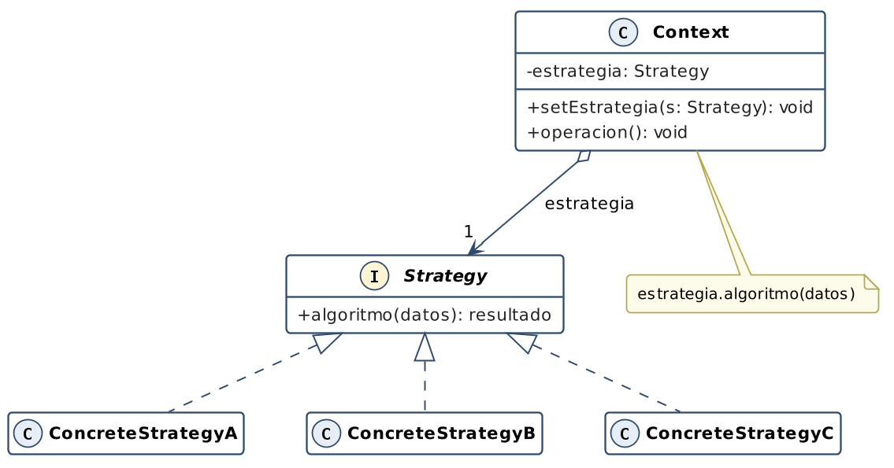
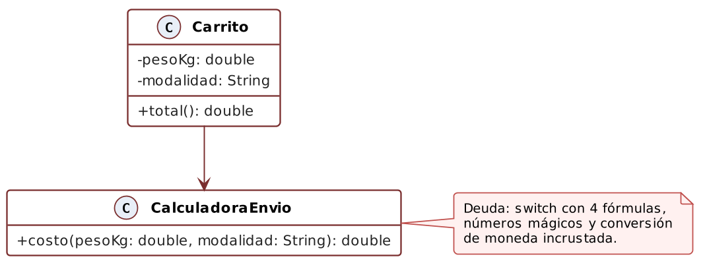
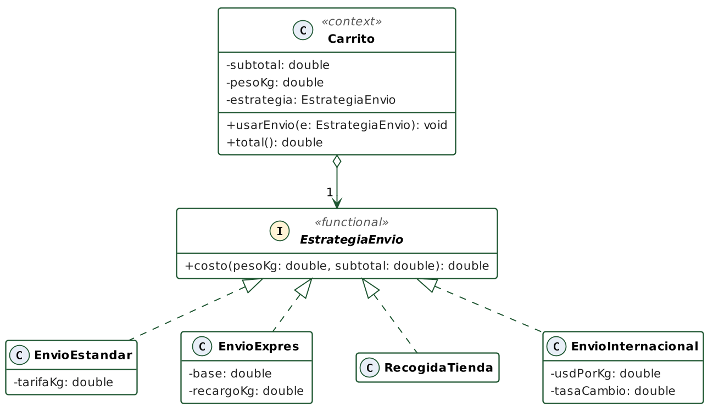

# 21. Strategy (Estrategia)

**Categoría:** Comportamiento · **Ámbito:** Objeto · **También conocido como:** Policy, Política

> **Intención.** Definir una familia de algoritmos, encapsular cada uno de ellos y hacerlos intercambiables. Permite que el algoritmo varíe independientemente de los clientes que lo usan.

## Estructura genérica



## 1. Problema: código con deuda técnica (`problema/`)

CalculadoraEnvio.costo() recibe la modalidad como String y contiene las cuatro fórmulas en un switch, con constantes mágicas y una conversión de moneda incrustada.



**Deuda técnica identificada:**

- Switch sobre un String con todas las fórmulas: método largo y con baja cohesión.
- Números mágicos (tarifas, recargos, tasa de cambio) dispersos en el código.
- Agregar una modalidad (envío verde, por ejemplo) modifica la calculadora (viola OCP).
- No es posible probar ni reutilizar una fórmula de forma aislada.

## 2. Solución refactorizada con el patrón (`solucion/`)

EstrategiaEnvio es una interfaz funcional. Cada modalidad es una clase con su fórmula y sus parámetros explícitos. Carrito (contexto) delega el cálculo en la estrategia configurada. Una modalidad nueva puede añadirse incluso como lambda sin tocar código existente.



## 3. Ejemplos adicionales (`ejemplos/`)

| Paquete | Ejemplo | Descripción |
|---|---|---|
| `ejemplos/descuentos` | Descuentos combinables con lambdas | Estrategias funcionales de descuento que se componen con andThen y se eligen en tiempo de ejecución. |
| `ejemplos/ordenamiento` | Comparator como estrategia | Distintos criterios de ordenamiento de productos encadenados con thenComparing. |

## Cómo ejecutar

```bash
scripts/ejecutar.sh strategy            # todas las demos de este patrón
java -cp target/classes edu.ingsoft.gof.comportamiento.strategy.problema.Demo
java -cp target/classes edu.ingsoft.gof.comportamiento.strategy.solucion.Demo
```

## Salida esperada de la solución

```text
estandar       total: $     207,500
expres         total: $     223,250
tienda         total: $     200,000
internacional  total: $     391,938
verde          total: $     200,000
```

## Preguntas de estudio

1. Refactorice el ejemplo para que la estrategia se elija desde la configuración sin un switch. ¿Dónde vive ahora la decisión?
2. Compare Strategy y Template Method en términos de acoplamiento y momento de enlace.
3. ¿Cuándo una lambda es suficiente como estrategia y cuándo conviene una clase con nombre?

[← Volver al índice](../../../../../../../../README.md)
