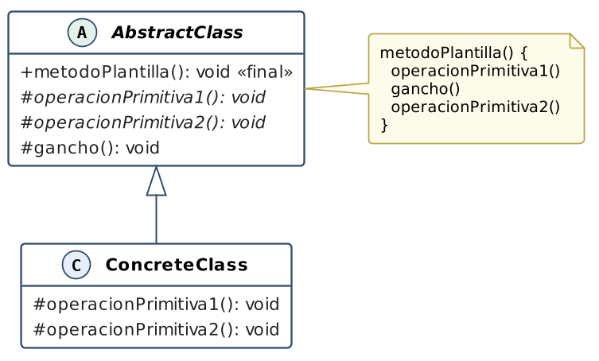
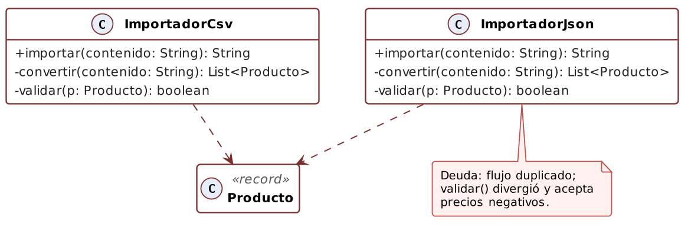
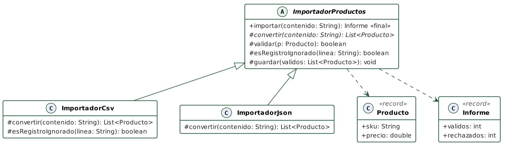

# 22. Template Method (Método Plantilla)

**Categoría:** Comportamiento · **Ámbito:** Clase · **También conocido como:** Método plantilla

> **Intención.** Definir en una operación el esqueleto de un algoritmo, delegando en las subclases algunos de sus pasos. Permite que las subclases redefinan ciertos pasos de un algoritmo sin cambiar su estructura.

## Estructura genérica



## 1. Problema: código con deuda técnica (`problema/`)

ImportadorCsv e ImportadorJson repiten el flujo completo. La validación del importador JSON quedó desactualizada y acepta precios negativos.



**Deuda técnica identificada:**

- Código duplicado (flujo idéntico en dos clases): violación de DRY.
- Divergencia: la regla de validación se corrigió en un importador y no en el otro.
- No hay un punto único para cambiar el orden de los pasos o agregar uno nuevo (por ejemplo, auditoría).
- Agregar un formato (XML) implica copiar y pegar todo el flujo otra vez.

## 2. Solución refactorizada con el patrón (`solucion/`)

ImportadorProductos define importar() como método plantilla final. El paso variable convertir() es abstracto; validar() es común y ahora corrige el error en ambos formatos; esRegistroIgnorado() es un gancho opcional. Agregar XML implica escribir solo convertir().



## 3. Ejemplos adicionales (`ejemplos/`)

| Paquete | Ejemplo | Descripción |
|---|---|---|
| `ejemplos/juegos` | Juegos por turnos | El esqueleto jugar() es común; ajedrez y parqués definen sus pasos. |
| `ejemplos/jdk` | AbstractList del JDK | Implementar get() y size() basta para obtener una lista completa gracias a los métodos plantilla del JDK. |

## Cómo ejecutar

```bash
scripts/ejecutar.sh templatemethod            # todas las demos de este patrón
java -cp target/classes edu.ingsoft.gof.comportamiento.templatemethod.problema.Demo
java -cp target/classes edu.ingsoft.gof.comportamiento.templatemethod.solucion.Demo
```

## Salida esperada de la solución

```text
ImportadorCsv: 2 válidos, 1 rechazados
ImportadorJson: 2 válidos, 1 rechazados   <- consistente
```

## Preguntas de estudio

1. ¿Por qué el método plantilla debe ser final? ¿Qué podría ocurrir si no lo es?
2. Diferencie entre operación abstracta y gancho (hook). Dé un ejemplo de cada una en el JDK.
3. Reescriba el importador usando Strategy (composición). ¿Qué gana y qué pierde?

[← Volver al índice](../../../../../../../../README.md)
