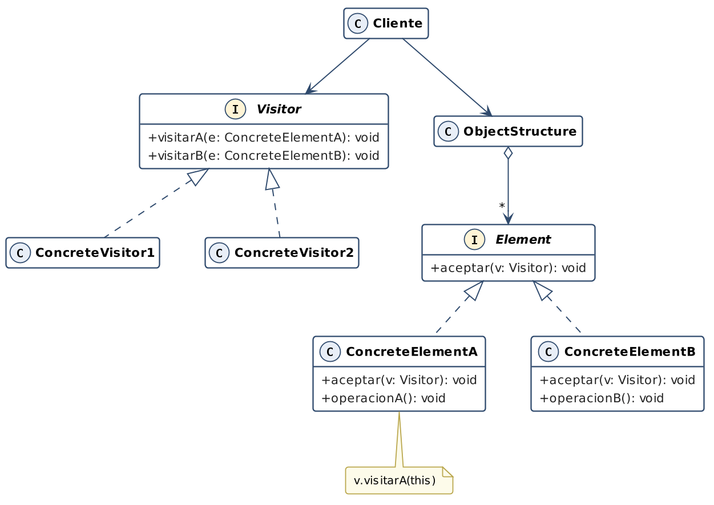
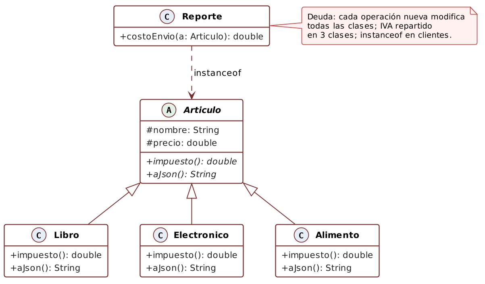
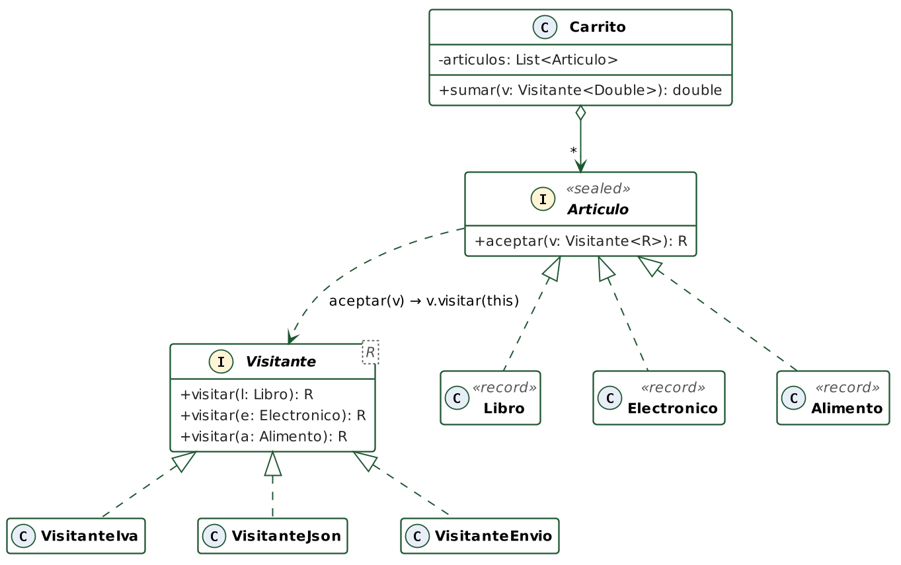

# 23. Visitor (Visitante)

**Categoría:** Comportamiento · **Ámbito:** Objeto · **También conocido como:** Visitante

> **Intención.** Representar una operación que debe realizarse sobre los elementos de una estructura de objetos. Permite definir una nueva operación sin cambiar las clases de los elementos sobre los que opera.

## Estructura genérica



## 1. Problema: código con deuda técnica (`problema/`)

Cada clase de producto implementa impuesto() y aJson(). Para agregar costoEnvio() hay que modificar las tres clases; además, un reporte usa instanceof para casos especiales.



**Deuda técnica identificada:**

- Clases de dominio contaminadas con operaciones de distintas áreas (fiscal, serialización, logística): viola SRP.
- Cada operación nueva modifica todas las clases de la jerarquía (shotgun surgery).
- La lógica de una operación (por ejemplo, el IVA) está repartida en varias clases.
- Uso de instanceof en los clientes para casos especiales.

## 2. Solución refactorizada con el patrón (`solucion/`)

Articulo declara aceptar(Visitante<R>). Cada producto implementa el doble despacho. Las operaciones viven en visitantes: VisitanteIva (reglas fiscales), VisitanteJson (serialización) y VisitanteEnvio, agregado sin modificar ninguna clase de producto.



## 3. Ejemplos adicionales (`ejemplos/`)

| Paquete | Ejemplo | Descripción |
|---|---|---|
| `ejemplos/expresiones` | Visitantes sobre un AST | Un mismo árbol de expresiones se evalúa y se imprime con dos visitantes diferentes. |
| `ejemplos/figuras` | Visitor sobre un Composite | Área total y exportación SVG de un dibujo compuesto por figuras y grupos. |

## Cómo ejecutar

```bash
scripts/ejecutar.sh visitor            # todas las demos de este patrón
java -cp target/classes edu.ingsoft.gof.comportamiento.visitor.problema.Demo
java -cp target/classes edu.ingsoft.gof.comportamiento.visitor.solucion.Demo
```

## Salida esperada de la solución

```text
{"tipo":"libro","nombre":"Design Patterns"}
{"tipo":"electronico","nombre":"Audífonos"}
{"tipo":"alimento","nombre":"Café 500 g"}
IVA: $49,100 | Envío: $28,000
```

## Preguntas de estudio

1. Explique el doble despacho y por qué Java (con despacho simple) lo necesita para Visitor.
2. ¿Qué ocurre si se agrega una nueva clase Servicio a la jerarquía de artículos? Evalúe el impacto.
3. Compare Visitor con switch por patrones sobre interfaces selladas (Java 21).

[← Volver al índice](../../../../../../../../README.md)
