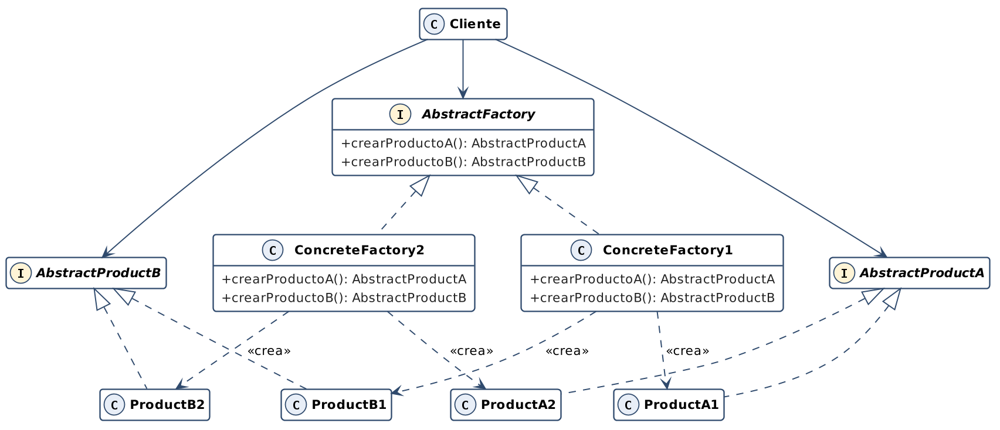
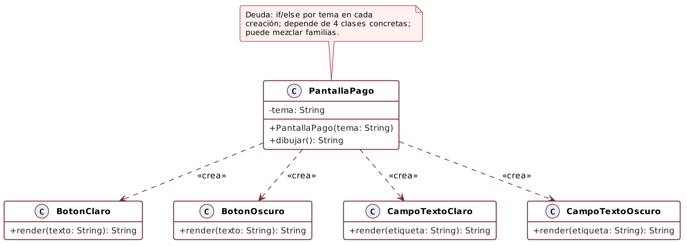
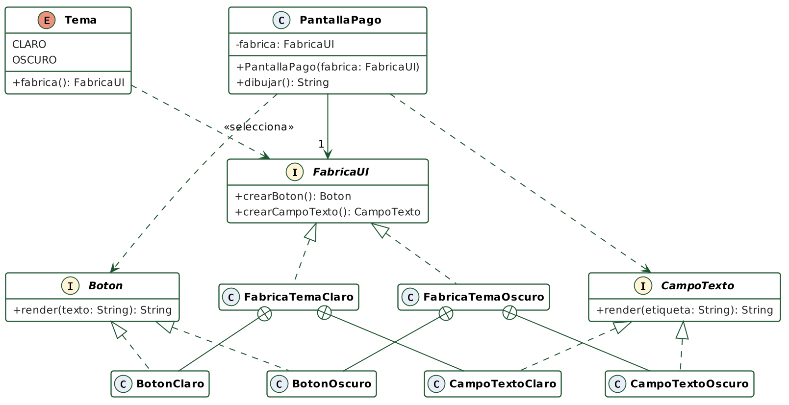

# 1. Abstract Factory (Fábrica Abstracta)

**Categoría:** Creacional · **Ámbito:** Objeto · **También conocido como:** Kit

> **Intención.** Proporcionar una interfaz para crear familias de objetos relacionados o dependientes sin especificar sus clases concretas.

## Estructura genérica



## 1. Problema: código con deuda técnica (`problema/`)

PantallaPago construye sus componentes preguntando por el nombre del tema en cada punto de creación. Depende de las cuatro clases concretas y la decisión «qué familia usar» se repite.



**Deuda técnica identificada:**

- Condicionales repetidos (if/else sobre un String) en cada punto de creación: shotgun surgery al agregar un tema.
- Acoplamiento a clases concretas: el cliente conoce BotonClaro, BotonOscuro, CampoTextoClaro y CampoTextoOscuro.
- Riesgo de inconsistencia: nada impide combinar un botón oscuro con un campo claro (ya ocurre en la rama por defecto).
- Violación de OCP: un tema nuevo exige editar el cliente; violación de DIP: el cliente depende de detalles.
- Obsesión por primitivos: el tema es un String libre, propenso a errores tipográficos.

## 2. Solución refactorizada con el patrón (`solucion/`)

Se introduce la interfaz FabricaUI con una operación por producto. Cada tema es una fábrica concreta que solo crea productos de su familia (implementados como clases anidadas privadas). PantallaPago recibe la fábrica por constructor y ya no contiene condicionales; la selección del tema ocurre una sola vez, en la raíz de composición, a partir de un enum.



## 3. Ejemplos adicionales (`ejemplos/`)

| Paquete | Ejemplo | Descripción |
|---|---|---|
| `ejemplos/persistencia` | Familias de persistencia (SQL y documental) | Una fábrica crea conexiones y repositorios compatibles entre sí para PostgreSQL o MongoDB. |
| `ejemplos/nube` | Proveedores de nube (AWS y Azure) | Una fábrica entrega almacenamiento y colas de mensajes del mismo proveedor. |

## Cómo ejecutar

```bash
scripts/ejecutar.sh abstractfactory            # todas las demos de este patrón
java -cp target/classes edu.ingsoft.gof.creacionales.abstractfactory.problema.Demo
java -cp target/classes edu.ingsoft.gof.creacionales.abstractfactory.solucion.Demo
```

## Salida esperada de la solución

```text
== CLARO ==
Tarjeta: ________ borde=#CCCCCC
[ Pagar ] fondo=#FFFFFF texto=#000000
== OSCURO ==
Tarjeta: ________ borde=#444444
[ Pagar ] fondo=#121212 texto=#FFFFFF
```

## Preguntas de estudio

1. ¿Por qué agregar un nuevo producto (por ejemplo, Checkbox) viola OCP en Abstract Factory mientras que agregar una nueva familia no lo hace?
2. ¿Qué diferencia hay entre una Fábrica Simple (método estático con switch) y Abstract Factory? ¿Cuándo basta la primera?
3. ¿Cómo implementaría la selección de la fábrica con inyección de dependencias en Spring?

[← Volver al índice](../../../../../../../../README.md)
