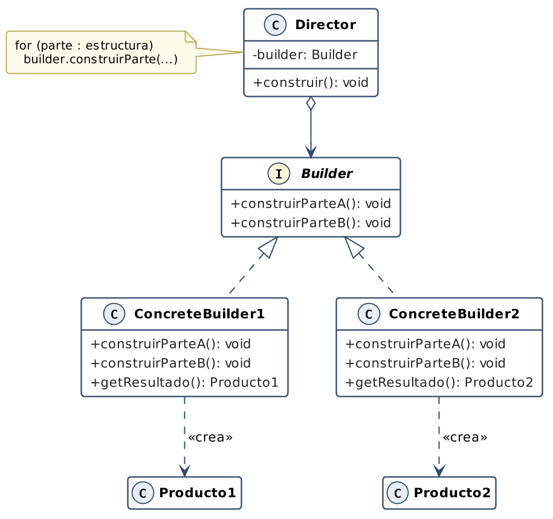
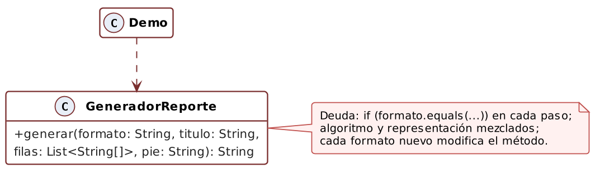
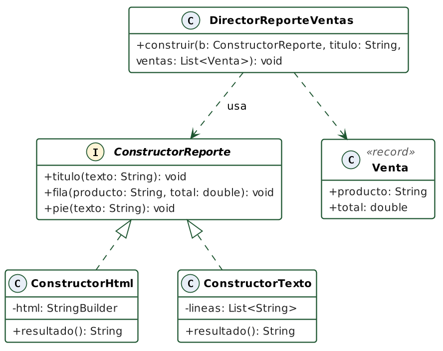

# 2. Builder (Constructor)

**Categoría:** Creacional · **Ámbito:** Objeto · **También conocido como:** Constructor

> **Intención.** Separar la construcción de un objeto complejo de su representación, de modo que el mismo proceso de construcción pueda crear representaciones diferentes.

## Estructura genérica



## 1. Problema: código con deuda técnica (`problema/`)

GeneradorReporte recibe el formato como String y, en cada paso de la construcción (encabezado, filas, cierre, pie), pregunta por él para decidir qué texto producir.



**Deuda técnica identificada:**

- Método largo con condicionales sobre el formato repetidos en cada paso (switch statements smell).
- Algoritmo de construcción y representación mezclados: dos razones de cambio en una clase (viola SRP).
- Agregar Markdown implica tocar cada rama del método (viola OCP) y aumenta el riesgo de regresiones.
- Lista de parámetros larga y uso de arreglos String[] en lugar de un modelo de dominio.

## 2. Solución refactorizada con el patrón (`solucion/`)

Se extrae la interfaz ConstructorReporte con un método por parte del reporte. El orden de armado queda en DirectorReporteVentas, que trabaja sobre un modelo de dominio (record Venta) y desconoce el formato. Cada formato es un ConcreteBuilder que acumula su propia representación y expone resultado(). Agregar Markdown es crear una clase nueva.



## 3. Ejemplos adicionales (`ejemplos/`)

| Paquete | Ejemplo | Descripción |
|---|---|---|
| `ejemplos/fluido` | Builder fluido para objetos inmutables | SolicitudHttp con parámetros opcionales, validación en build() y copia defensiva. |
| `ejemplos/pasos` | Step Builder (orden obligatorio) | Construcción de un Correo en la que el compilador obliga a definir destinatario y asunto. |

## Cómo ejecutar

```bash
scripts/ejecutar.sh builder            # todas las demos de este patrón
java -cp target/classes edu.ingsoft.gof.creacionales.builder.problema.Demo
java -cp target/classes edu.ingsoft.gof.creacionales.builder.solucion.Demo
```

## Salida esperada de la solución

```text
<h1>Ventas</h1>
<table>
  <tr><td>Teclado</td><td>120000</td></tr>
  <tr><td>Monitor</td><td>890000</td></tr>
</table>
<footer>Total: 1010000</footer>
VENTAS
======
Teclado          120000
Monitor          890000
-----------------------
Total: 1010000
```

## Preguntas de estudio

1. ¿Por qué en el patrón GoF el método para obtener el resultado está en el ConcreteBuilder y no en la interfaz Builder?
2. Compare el Builder GoF (con Director) y el Builder fluido de Bloch. ¿Qué problema resuelve cada uno?
3. ¿Cómo garantizaría con el sistema de tipos que un campo obligatorio no se omita al construir?

[← Volver al índice](../../../../../../../../README.md)
