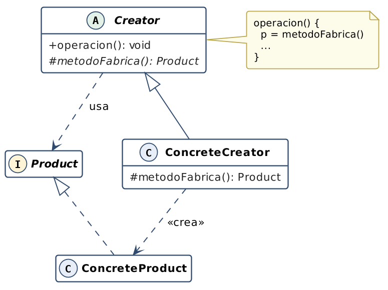
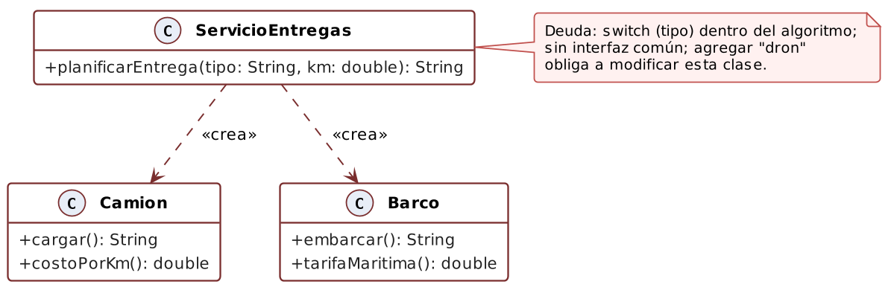
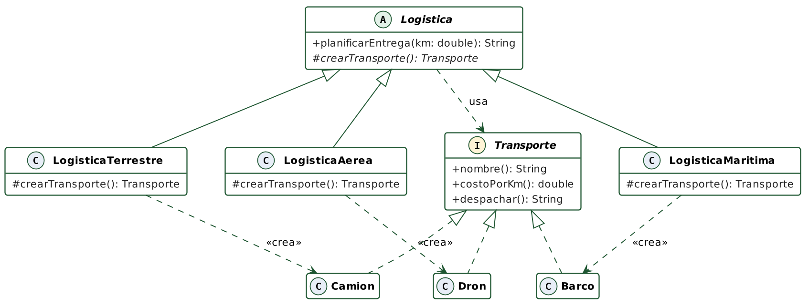

# 3. Factory Method (Método Fábrica)

**Categoría:** Creacional · **Ámbito:** Clase · **También conocido como:** Virtual Constructor, Constructor Virtual

> **Intención.** Definir una interfaz para crear un objeto, pero dejar que sean las subclases quienes decidan qué clase instanciar. Permite que una clase delegue en sus subclases la creación de objetos.

## Estructura genérica



## 1. Problema: código con deuda técnica (`problema/`)

ServicioEntregas contiene el algoritmo de planificación y, dentro de él, un switch que crea el transporte según un String. Agregar drones exige editar este método.



**Deuda técnica identificada:**

- Switch sobre un String dentro del algoritmo de negocio: código creacional mezclado con lógica de dominio.
- Acoplamiento a todas las clases concretas de transporte (Camion, Barco).
- Violación de OCP: cada modalidad nueva modifica y vuelve a probar ServicioEntregas.
- Errores en tiempo de ejecución por valores inválidos (IllegalArgumentException) en lugar de errores de compilación.
- Las clases de transporte no comparten interfaz: el costo se calcula con otro switch.

## 2. Solución refactorizada con el patrón (`solucion/`)

La interfaz Transporte unifica el comportamiento de los productos. Logistica (Creator) conserva el algoritmo planificarEntrega y delega la creación en el método abstracto crearTransporte(). Cada modalidad es un ConcreteCreator; agregar drones consistió en crear Dron y LogisticaAerea sin modificar código existente.



## 3. Ejemplos adicionales (`ejemplos/`)

| Paquete | Ejemplo | Descripción |
|---|---|---|
| `ejemplos/notificaciones` | Factory Method parametrizado con registro | Un Map de Supplier crea canales de notificación y permite registrar canales nuevos en tiempo de ejecución. |
| `ejemplos/exportadores` | Creator con producto por defecto | Un exportador de datos define un formateador por defecto (CSV) que las subclases redefinen (JSON). |

## Cómo ejecutar

```bash
scripts/ejecutar.sh factorymethod            # todas las demos de este patrón
java -cp target/classes edu.ingsoft.gof.creacionales.factorymethod.problema.Demo
java -cp target/classes edu.ingsoft.gof.creacionales.factorymethod.solucion.Demo
```

## Salida esperada de la solución

```text
Camión: cargado en bodega | costo $300,000
Barco: contenedor embarcado en puerto | costo $720,000
Dron: paquete asegurado y en vuelo | costo $20,000
```

## Preguntas de estudio

1. ¿Por qué Factory Method tiene ámbito de clase y Abstract Factory ámbito de objeto?
2. ¿Es Calendar.getInstance() un Factory Method en el sentido GoF? Argumente.
3. ¿Cómo eliminaría la necesidad de subclases usando un registro de Supplier? ¿Qué se pierde?

[← Volver al índice](../../../../../../../../README.md)
