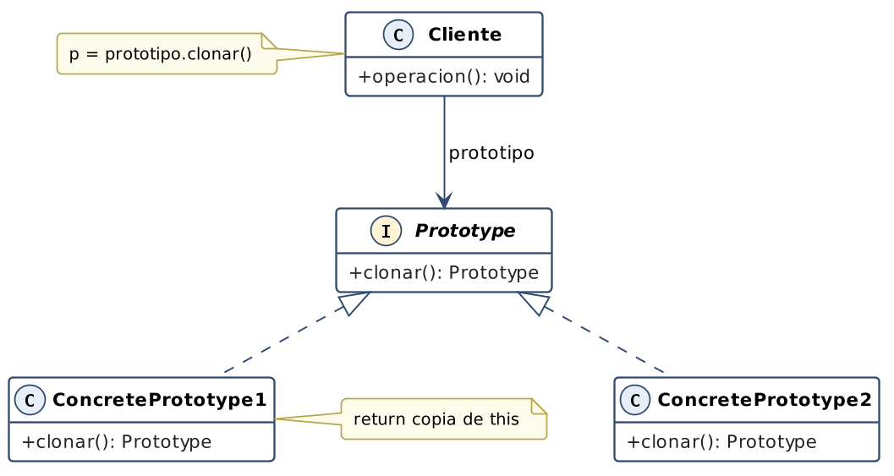
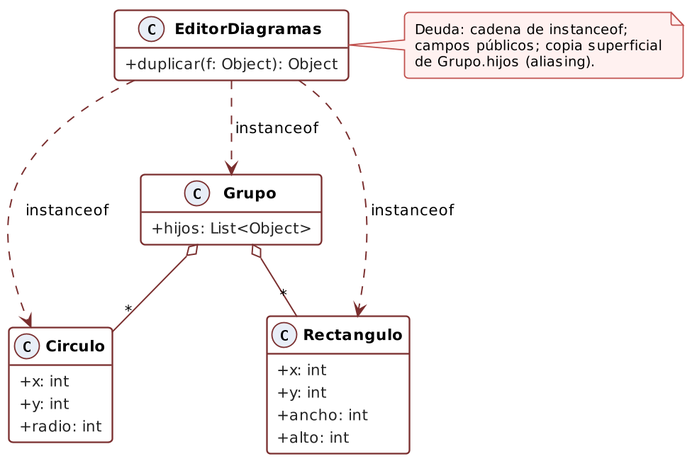
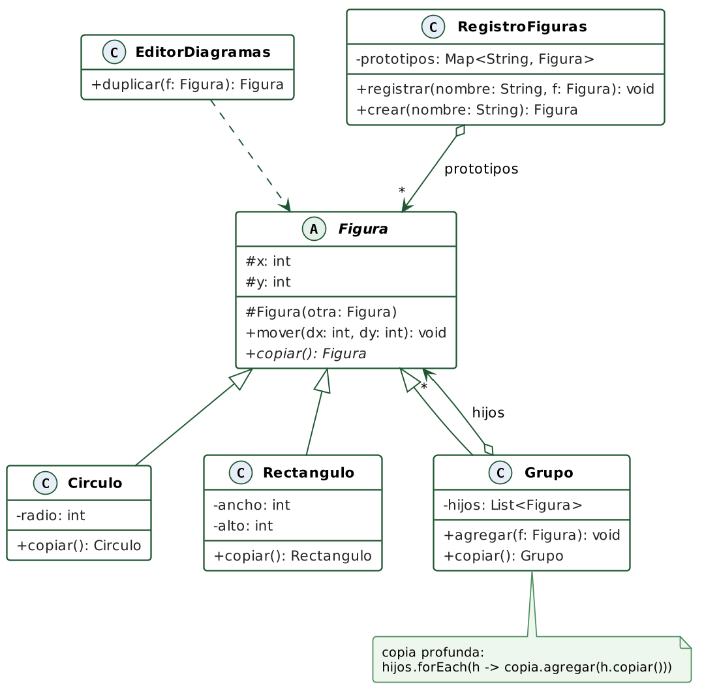

# 4. Prototype (Prototipo)

**Categoría:** Creacional · **Ámbito:** Objeto · **También conocido como:** Prototipo, Clon

> **Intención.** Especificar los tipos de objetos a crear por medio de una instancia prototípica, y crear nuevos objetos copiando dicho prototipo.

## Estructura genérica



## 1. Problema: código con deuda técnica (`problema/`)

EditorDiagramas duplica figuras con una cadena de instanceof y copia los campos a mano. El grupo se copia de forma superficial: comparte la lista de hijos con el original.



**Deuda técnica identificada:**

- Cadena de instanceof: cada figura nueva obliga a modificar el editor (viola OCP).
- Rompe el encapsulamiento: el editor accede a los campos internos de cada figura para copiarlos.
- Copia superficial accidental: el duplicado de un Grupo comparte la lista de hijos (aliasing) y mover uno mueve ambos.
- Las figuras desconocidas devuelven null en silencio (falla tarde).

## 2. Solución refactorizada con el patrón (`solucion/`)

Figura declara el método abstracto copiar() con retorno covariante. Cada figura se copia usando su constructor de copia; Grupo copia en profundidad a sus hijos. El editor duplica cualquier figura polimórficamente y RegistroFiguras ofrece una paleta de prototipos.



## 3. Ejemplos adicionales (`ejemplos/`)

| Paquete | Ejemplo | Descripción |
|---|---|---|
| `ejemplos/plantillas` | Registro de plantillas de documentos | Contratos preconfigurados que se clonan y personalizan sin alterar la plantilla. |
| `ejemplos/profundidad` | Copia superficial frente a copia profunda | Muestra el aliasing causado por Object.clone() y su corrección. |

## Cómo ejecutar

```bash
scripts/ejecutar.sh prototype            # todas las demos de este patrón
java -cp target/classes edu.ingsoft.gof.creacionales.prototype.problema.Demo
java -cp target/classes edu.ingsoft.gof.creacionales.prototype.solucion.Demo
```

## Salida esperada de la solución

```text
original = Grupo[Circulo(0,0,r=10)]
copia    = Grupo[Circulo(20,20,r=10), Rect(5,5,30x10)]
de la paleta: Circulo(0,0,r=25), Rect(0,0,120x60)
```

## Preguntas de estudio

1. ¿Por qué Cloneable se considera un diseño defectuoso en Java? ¿Qué alternativas recomienda Effective Java?
2. Diseñe la copia profunda de un grafo con ciclos. ¿Qué estructura auxiliar necesita?
3. ¿En qué casos compartir objetos inmutables vuelve innecesario el patrón?

[← Volver al índice](../../../../../../../../README.md)
