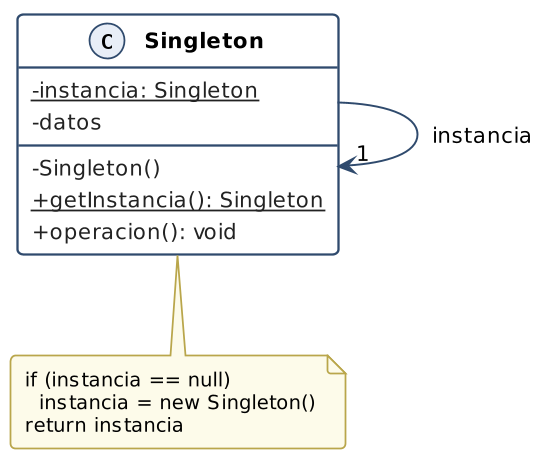
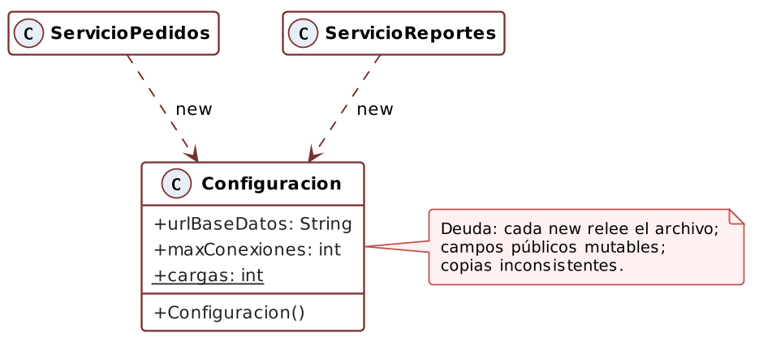
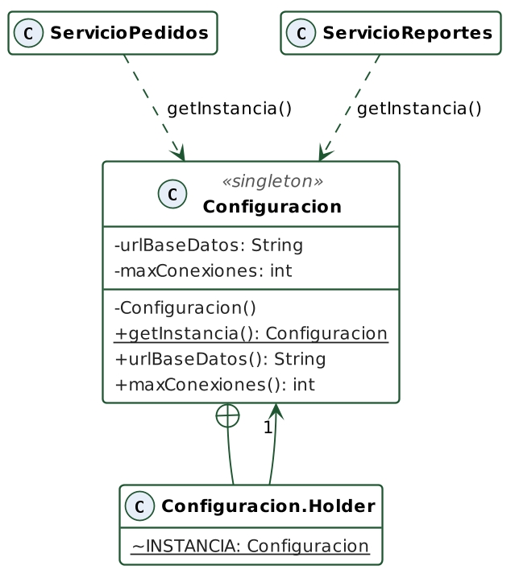

# 5. Singleton (Instancia Única)

**Categoría:** Creacional · **Ámbito:** Objeto · **También conocido como:** Instancia única

> **Intención.** Garantizar que una clase tenga una única instancia y proporcionar un punto de acceso global a ella.

## Estructura genérica



## 1. Problema: código con deuda técnica (`problema/`)

Cada servicio crea su propio objeto Configuracion con new. El constructor lee el archivo cada vez y los campos son públicos y mutables, por lo que los servicios terminan viendo valores distintos.



**Deuda técnica identificada:**

- Carga repetida de un recurso costoso (archivo, red) en cada new Configuracion().
- Estado duplicado e inconsistente: un servicio modifica su copia y los demás no se enteran.
- Campos públicos y mutables: cualquier clase puede cambiar la configuración.
- No hay control de concurrencia ni un punto único de acceso.

## 2. Solución refactorizada con el patrón (`solucion/`)

Configuracion tiene un constructor privado y se crea una sola vez mediante el idioma Holder. El estado es inmutable (final) y se expone con métodos de consulta. Los servicios obtienen siempre la misma instancia; la demostración crea 8 hilos concurrentes y comprueba que se carga un único objeto.



## 3. Ejemplos adicionales (`ejemplos/`)

| Paquete | Ejemplo | Descripción |
|---|---|---|
| `ejemplos/enumeracion` | Singleton con enum | Un registro de métricas thread-safe implementado como enum de un solo elemento. |
| `ejemplos/dcl` | Double-checked locking frente a inicialización ingenua | Compara una inicialización perezosa ingenua con una versión correcta con volatile. |

## Cómo ejecutar

```bash
scripts/ejecutar.sh singleton            # todas las demos de este patrón
java -cp target/classes edu.ingsoft.gof.creacionales.singleton.problema.Demo
java -cp target/classes edu.ingsoft.gof.creacionales.singleton.solucion.Demo
```

## Salida esperada de la solución

```text
Instancias distintas vistas por 8 hilos: 1
Cargas del archivo: 1
Pedidos: 10 conexiones | Reportes: jdbc:postgresql://db:5432/tienda
```

## Preguntas de estudio

1. ¿Por qué el double-checked locking sin volatile es incorrecto en el modelo de memoria de Java?
2. ¿Cómo rompe la reflexión o la deserialización un Singleton clásico y por qué el enum no tiene ese problema?
3. Proponga una refactorización para que un servicio que usa Configuracion.getInstancia() pueda probarse con un doble de prueba.

[← Volver al índice](../../../../../../../../README.md)
