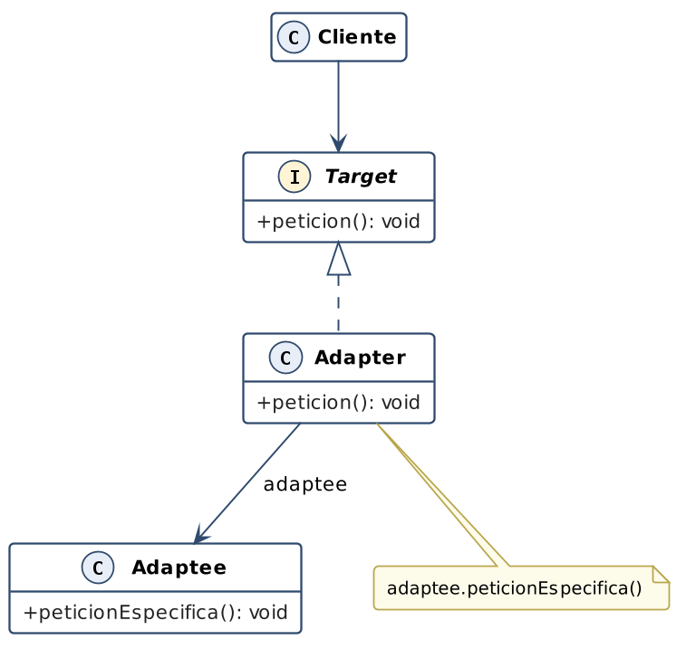
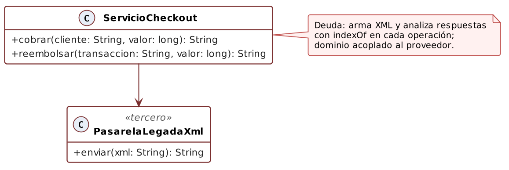
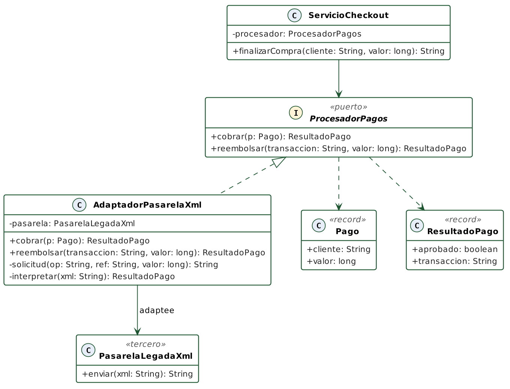

# 6. Adapter (Adaptador)

**Categoría:** Estructural · **Ámbito:** Clase y objeto · **También conocido como:** Wrapper, Envoltorio

> **Intención.** Convertir la interfaz de una clase en otra interfaz que esperan los clientes. Permite que colaboren clases que de otro modo no podrían hacerlo por tener interfaces incompatibles.

## Estructura genérica



## 1. Problema: código con deuda técnica (`problema/`)

ServicioCheckout arma XML a mano, invoca la pasarela legada y extrae los campos de la respuesta con indexOf. La misma lógica se repite para cobrar y para reembolsar.



**Deuda técnica identificada:**

- Detalles de infraestructura (XML, formato de respuesta) mezclados con la lógica de negocio.
- Código duplicado para construir solicitudes y analizar respuestas en cada operación.
- Análisis frágil de cadenas (indexOf/substring) disperso en el dominio.
- Acoplamiento directo a un proveedor concreto: cambiarlo afecta a todo el checkout (viola DIP).
- Imposible probar el checkout sin la pasarela real.

## 2. Solución refactorizada con el patrón (`solucion/`)

El dominio declara la interfaz ProcesadorPagos con sus propios tipos (records Pago y ResultadoPago). AdaptadorPasarelaXml encapsula toda la traducción hacia y desde XML reutilizando la pasarela legada sin modificarla. ServicioCheckout depende solo de la interfaz y puede probarse con un procesador simulado.



## 3. Ejemplos adicionales (`ejemplos/`)

| Paquete | Ejemplo | Descripción |
|---|---|---|
| `ejemplos/clase` | Adaptador de clases (por herencia) | Un sensor heredado en Fahrenheit se adapta por herencia a la interfaz SensorCelsius. |
| `ejemplos/colecciones` | Adaptadores del JDK | Uso de Arrays.asList, InputStreamReader y Collections.enumeration como adaptadores reales. |

## Cómo ejecutar

```bash
scripts/ejecutar.sh adapter            # todas las demos de este patrón
java -cp target/classes edu.ingsoft.gof.estructurales.adapter.problema.Demo
java -cp target/classes edu.ingsoft.gof.estructurales.adapter.solucion.Demo
```

## Salida esperada de la solución

```text
Compra confirmada (TX1000)
Pago rechazado
Reembolso: ResultadoPago[aprobado=true, transaccion=TX1002]
Con simulado: Compra confirmada (TEST-1)
```

## Preguntas de estudio

1. ¿Por qué en Java el adaptador de clases exige que Target sea una interfaz?
2. Explique la relación entre Adapter y los puertos y adaptadores de la arquitectura hexagonal.
3. ¿Dónde deben traducirse las excepciones del sistema heredado y por qué?

[← Volver al índice](../../../../../../../../README.md)
