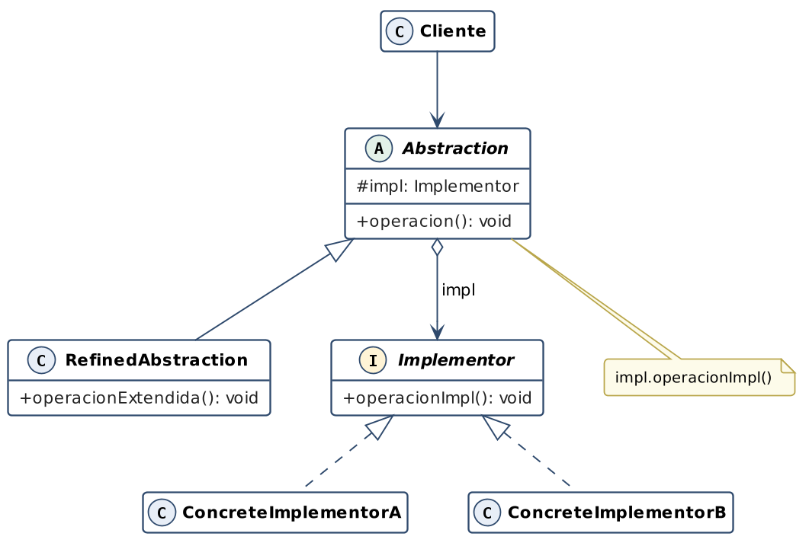
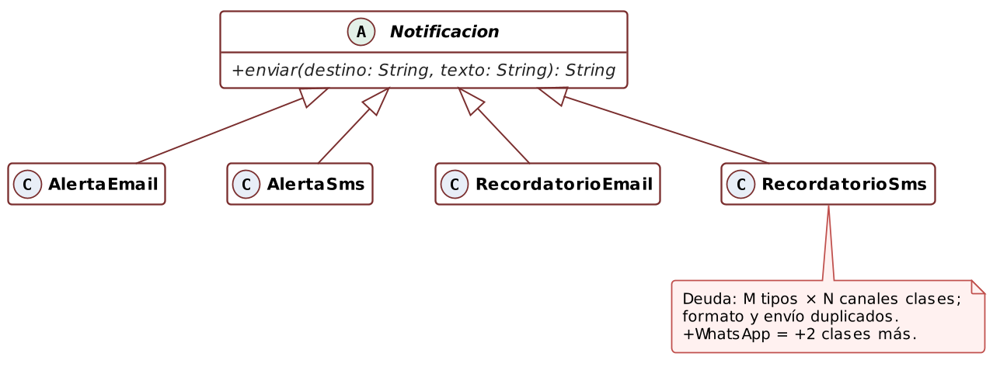
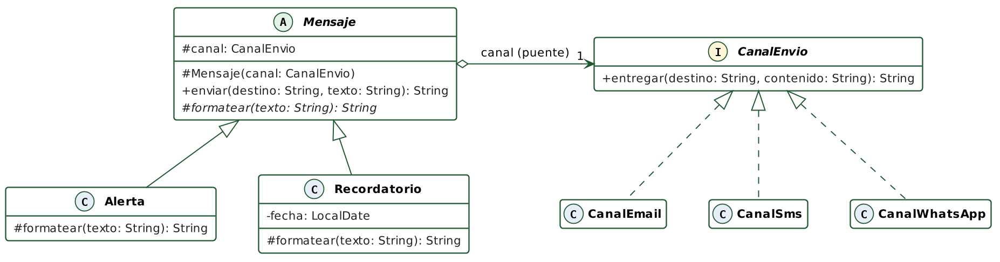

# 7. Bridge (Puente)

**Categoría:** Estructural · **Ámbito:** Objeto · **También conocido como:** Handle/Body, Manejador/Cuerpo

> **Intención.** Desacoplar una abstracción de su implementación, de modo que ambas puedan variar de forma independiente.

## Estructura genérica



## 1. Problema: código con deuda técnica (`problema/`)

Existe una clase por combinación (AlertaEmail, AlertaSms, RecordatorioEmail, RecordatorioSms). El formateo y el envío se duplican en cada una.



**Deuda técnica identificada:**

- Explosión combinatoria de clases (M tipos × N canales).
- Duplicación: el formato de alerta está repetido en AlertaEmail y AlertaSms; el envío SMS, en AlertaSms y RecordatorioSms.
- Dos razones de cambio por clase (contenido y transporte): viola SRP.
- Agregar un canal obliga a crear tantas clases como tipos de mensaje existan.

## 2. Solución refactorizada con el patrón (`solucion/`)

Mensaje (abstracción) contiene una referencia a CanalEnvio (implementador). Alerta y Recordatorio solo se ocupan del contenido; los canales solo del transporte. Agregar WhatsApp fue crear una clase; cualquier tipo de mensaje puede enviarse por cualquier canal.



## 3. Ejemplos adicionales (`ejemplos/`)

| Paquete | Ejemplo | Descripción |
|---|---|---|
| `ejemplos/control` | Control remoto y dispositivos | Controles básicos y avanzados operan televisores y radios. |
| `ejemplos/graficos` | Figuras y motores de renderizado | Figuras geométricas que se dibujan como SVG o como texto ASCII. |

## Cómo ejecutar

```bash
scripts/ejecutar.sh bridge            # todas las demos de este patrón
java -cp target/classes edu.ingsoft.gof.estructurales.bridge.problema.Demo
java -cp target/classes edu.ingsoft.gof.estructurales.bridge.solucion.Demo
```

## Salida esperada de la solución

```text
SMTP -> ops@tienda.co | ⚠ ALERTA: SERVIDOR CAÍDO
SMS-GW -> 3001234567 | ⚠ ALERTA: SERVIDOR CAÍDO
WA-API -> 3001234567 | Recordatorio (2026-11-17): su cita es a las 9:00
Clases necesarias para 2 tipos + 3 canales: 5
```

## Preguntas de estudio

1. Calcule cuántas clases se necesitan con y sin Bridge para 4 tipos de mensaje y 5 canales.
2. ¿Por qué se dice que el JDBC es un ejemplo de Bridge y no de Adapter?
3. ¿En qué se diferencia estructuralmente Bridge de Strategy? ¿Y en intención?

[← Volver al índice](../../../../../../../../README.md)
