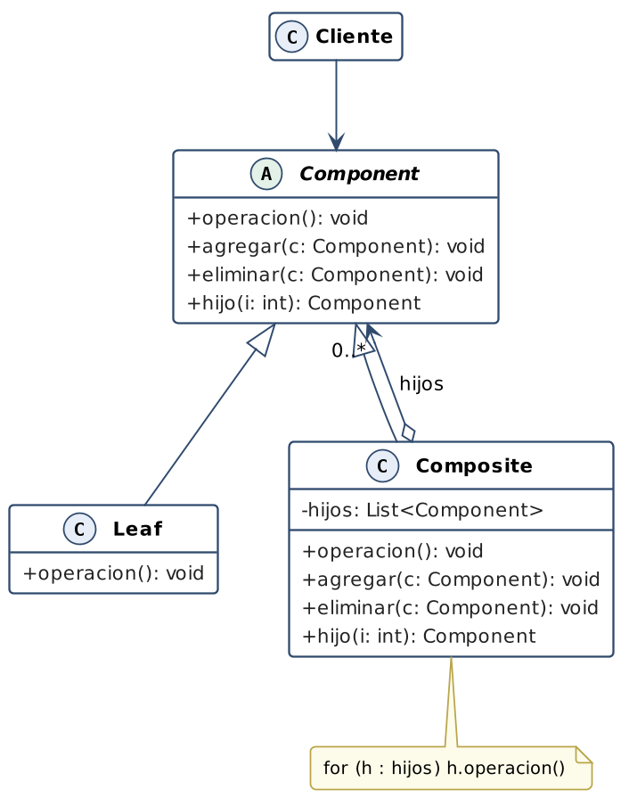
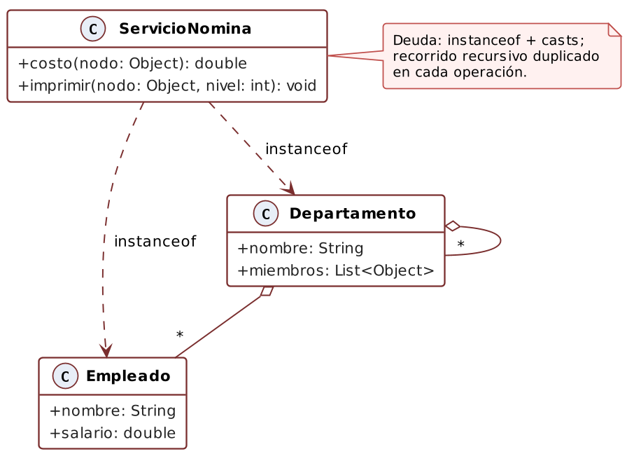
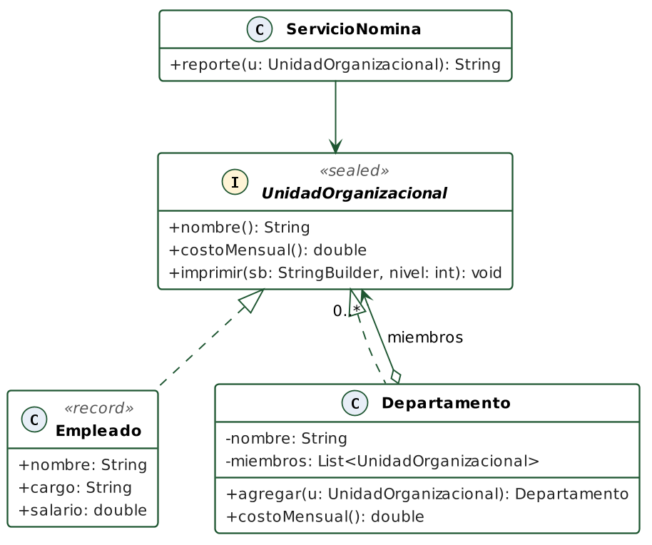

# 8. Composite (Compuesto)

**Categoría:** Estructural · **Ámbito:** Objeto · **También conocido como:** Compuesto, Árbol de objetos

> **Intención.** Componer objetos en estructuras de árbol para representar jerarquías parte-todo. Permite que los clientes traten de manera uniforme a los objetos individuales y a las composiciones.

## Estructura genérica



## 1. Problema: código con deuda técnica (`problema/`)

ServicioNomina recorre el organigrama con instanceof y casts. Las operaciones de costo y de impresión duplican la lógica de recorrido.



**Deuda técnica identificada:**

- Comprobaciones de tipo (instanceof) y casts en el cliente: viola OCP y el principio de sustitución.
- La lógica recursiva de recorrido se duplica en cada operación del cliente.
- Departamento expone su lista interna (List<Object>), sin tipado ni encapsulamiento.
- Agregar un nuevo tipo de nodo (por ejemplo, Contratista) obliga a modificar todas las operaciones.

## 2. Solución refactorizada con el patrón (`solucion/`)

La interfaz sellada UnidadOrganizacional declara costoMensual() e imprimir(). Empleado (hoja) devuelve su salario; Departamento (compuesto) suma recursivamente a sus hijos. El servicio de nómina opera sobre cualquier nodo sin conocer su tipo.



## 3. Ejemplos adicionales (`ejemplos/`)

| Paquete | Ejemplo | Descripción |
|---|---|---|
| `ejemplos/archivos` | Sistema de archivos | Archivos y carpetas con cálculo recursivo de tamaño y búsqueda por extensión. |
| `ejemplos/menu` | Menú de restaurante | Menús y submenús con platos; impresión jerárquica y filtro vegetariano. |

## Cómo ejecutar

```bash
scripts/ejecutar.sh composite            # todas las demos de este patrón
java -cp target/classes edu.ingsoft.gof.estructurales.composite.problema.Demo
java -cp target/classes edu.ingsoft.gof.estructurales.composite.solucion.Demo
```

## Salida esperada de la solución

```text
+ TI
  - Ana (Arquitecta)
  + Soporte
    - Luis (Analista N1)
    - Sara (Analista N2)
Costo mensual de TI: $18,200,000
- Pedro (Pasante)
Costo mensual de Pedro: $1,400,000
```

## Preguntas de estudio

1. Explique el dilema transparencia contra seguridad y cómo lo resuelven las interfaces selladas de Java 17.
2. ¿Cómo evitaría ciclos al agregar un departamento dentro de sí mismo?
3. ¿Cuándo convendría cachear costoMensual() en Departamento y cómo se invalidaría?

[← Volver al índice](../../../../../../../../README.md)
