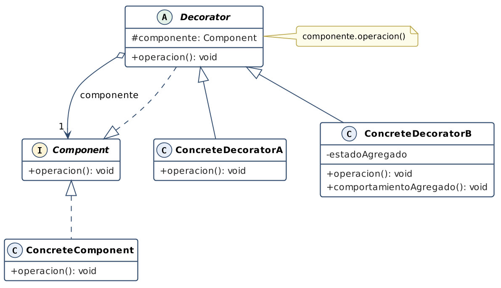
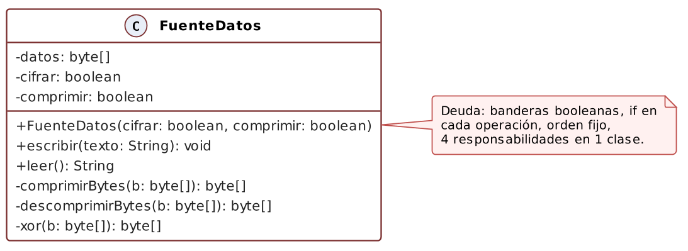
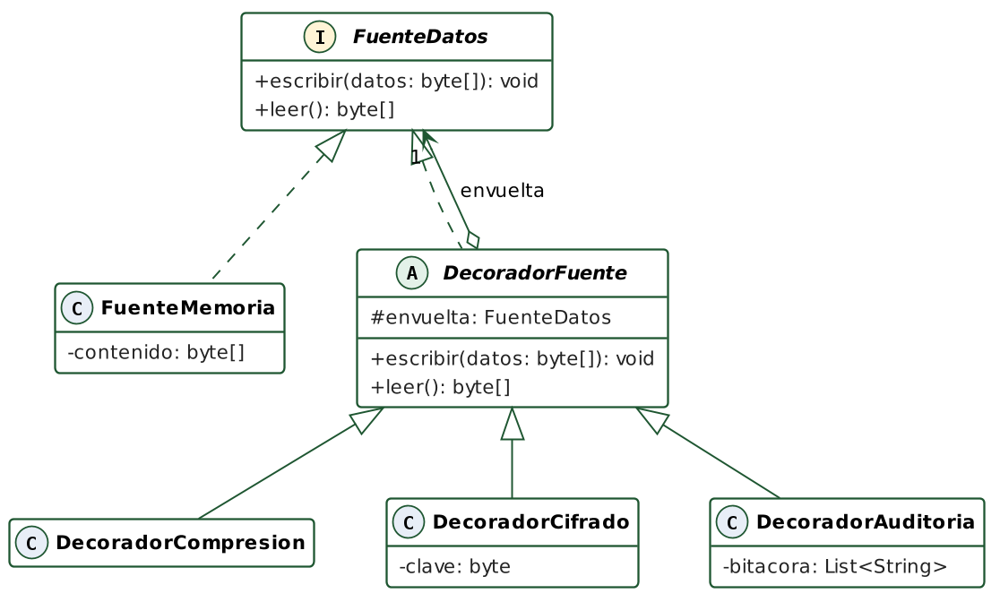

# 9. Decorator (Decorador)

**Categoría:** Estructural · **Ámbito:** Objeto · **También conocido como:** Wrapper, Envoltorio

> **Intención.** Asignar responsabilidades adicionales a un objeto dinámicamente. Los decoradores ofrecen una alternativa flexible a la herencia para extender la funcionalidad.

## Estructura genérica



## 1. Problema: código con deuda técnica (`problema/`)

FuenteDatos recibe banderas cifrar y comprimir en su constructor. Los métodos escribir y leer aplican cada transformación con if y el orden está fijado en el código.



**Deuda técnica identificada:**

- Banderas booleanas en el constructor (flag arguments) y condicionales en cada operación.
- Varias responsabilidades en una clase: almacenamiento, compresión y cifrado (viola SRP).
- Agregar una capacidad (auditoría, codificación) obliga a modificar la clase (viola OCP).
- El orden de las transformaciones está fijado; leer debe invertirlo manualmente y es fácil equivocarse.
- La alternativa por herencia genera 2^n subclases para n capacidades.

## 2. Solución refactorizada con el patrón (`solucion/`)

FuenteDatos es la interfaz común. FuenteMemoria es el componente concreto. DecoradorFuente reenvía las llamadas y cada transformación es un decorador independiente (compresión con Deflater, cifrado XOR didáctico, auditoría). El cliente arma la cadena en el orden que necesite y la lectura invierte el orden automáticamente.



## 3. Ejemplos adicionales (`ejemplos/`)

| Paquete | Ejemplo | Descripción |
|---|---|---|
| `ejemplos/cafe` | Bebidas con complementos | Café al que se agregan leche, caramelo y crema con precio y descripción acumulados. |
| `ejemplos/servicios` | Decoradores transversales para un servicio | Reintentos, medición de tiempo y caché aplicados a un servicio de tasas de cambio. |

## Cómo ejecutar

```bash
scripts/ejecutar.sh decorator            # todas las demos de este patrón
java -cp target/classes edu.ingsoft.gof.estructurales.decorator.problema.Demo
java -cp target/classes edu.ingsoft.gof.estructurales.decorator.solucion.Demo
```

## Salida esperada de la solución

```text
Bytes originales: 300 | almacenados: 41
Lectura correcta: true
Bitácora: [escritura de 300 bytes, lectura de 300 bytes]
```

## Preguntas de estudio

1. Explique por qué comprimir y luego cifrar no produce el mismo resultado que cifrar y luego comprimir. ¿Cuál es más eficiente?
2. ¿Por qué java.io es un ejemplo de Decorator y qué problemas de usabilidad introdujo?
3. ¿Cómo afecta un decorador a equals() y hashCode() del objeto decorado?

[← Volver al índice](../../../../../../../../README.md)
