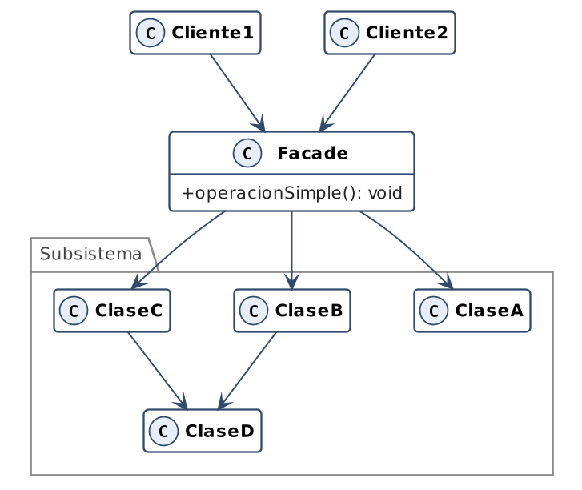
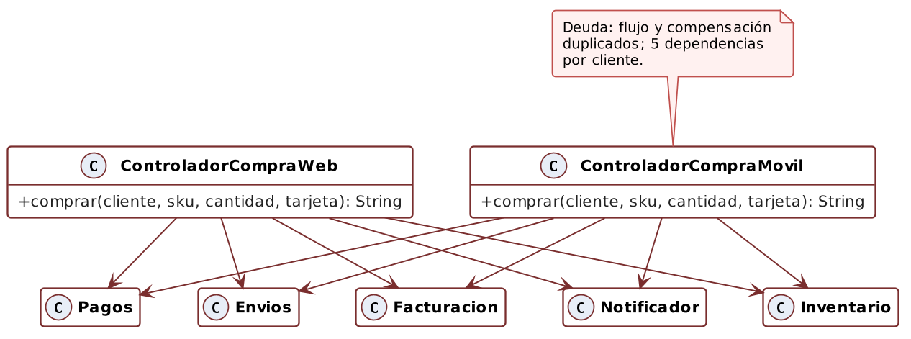
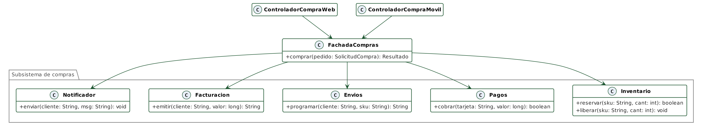

# 10. Facade (Fachada)

**Categoría:** Estructural · **Ámbito:** Objeto · **También conocido como:** Fachada

> **Intención.** Proporcionar una interfaz unificada para un conjunto de interfaces de un subsistema. Define una interfaz de alto nivel que hace que el subsistema sea más fácil de usar.

## Estructura genérica



## 1. Problema: código con deuda técnica (`problema/`)

ControladorCompraWeb conoce y coordina directamente los cinco subsistemas, incluida la compensación. El controlador móvil repite el mismo flujo.



**Deuda técnica identificada:**

- Alto acoplamiento: cada cliente depende de cinco clases del subsistema.
- Lógica de orquestación duplicada en varios clientes (web, móvil, lotes).
- Compensaciones (liberar reserva) fáciles de olvidar en alguno de los clientes.
- Cambiar el orden o agregar un paso (por ejemplo, antifraude) obliga a modificar todos los clientes.

## 2. Solución refactorizada con el patrón (`solucion/`)

FachadaCompras ofrece una sola operación comprar() que encapsula el flujo, el orden y la compensación. Los controladores web y móvil quedan reducidos a una línea y desconocen los subsistemas. Un cambio en el flujo se hace en un único lugar.



## 3. Ejemplos adicionales (`ejemplos/`)

| Paquete | Ejemplo | Descripción |
|---|---|---|
| `ejemplos/video` | Conversión de video | Una fachada oculta códecs, mezclador de audio y escritor de archivos tras un solo método convertir(). |
| `ejemplos/cinecasa` | Teatro en casa | Fachada que coordina proyector, amplificador, luces y reproductor para ver una película. |

## Cómo ejecutar

```bash
scripts/ejecutar.sh facade            # todas las demos de este patrón
java -cp target/classes edu.ingsoft.gof.estructurales.facade.problema.Demo
java -cp target/classes edu.ingsoft.gof.estructurales.facade.solucion.Demo
```

## Salida esperada de la solución

```text
  [notificación a ana] Compra OK FE-ANA-50000 guía GUIA-4899
Web:   OK FE-ANA-50000
Móvil: Pago rechazado
Stock SKU-1 (debería ser 4): 4
```

## Preguntas de estudio

1. ¿En qué se diferencia una Facade de un Mediator respecto a quién conoce a quién?
2. ¿Cómo evitaría que una fachada se convierta en un objeto dios?
3. Relacione Facade con el patrón Backend for Frontend (BFF) en microservicios.

[← Volver al índice](../../../../../../../../README.md)
