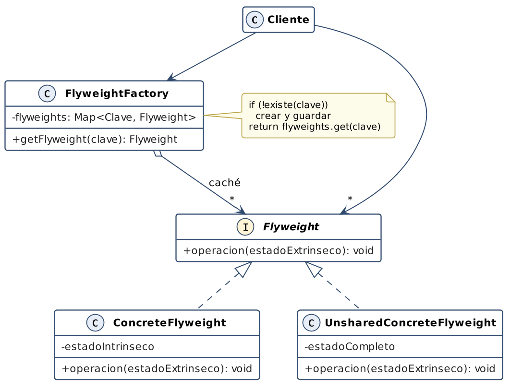
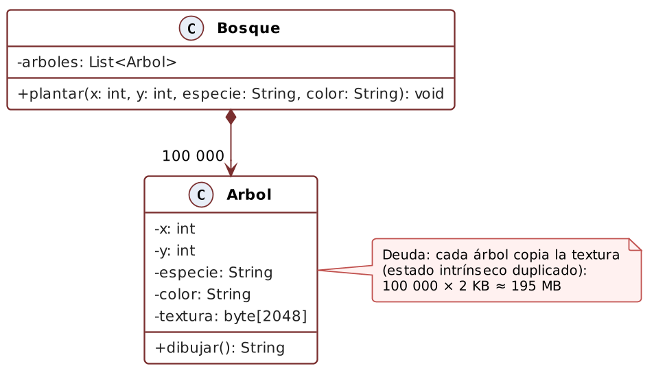
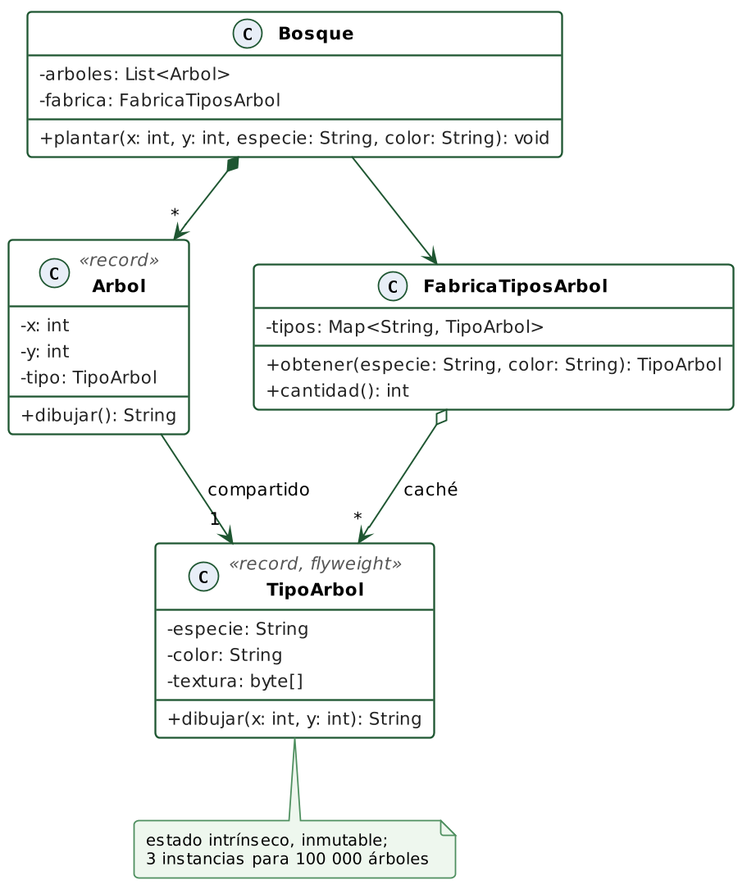

# 11. Flyweight (Peso Ligero)

**Categoría:** Estructural · **Ámbito:** Objeto · **También conocido como:** Peso ligero, Objeto compartido

> **Intención.** Usar un compartimiento para permitir un gran número de objetos de grano fino de forma eficiente.

## Estructura genérica



## 1. Problema: código con deuda técnica (`problema/`)

Cada objeto Arbol almacena su posición (estado extrínseco) junto con el nombre de la especie, el color y una textura de 2 KB (estado intrínseco). 100 000 árboles cargan 100 000 texturas, aunque solo hay 3 especies.



**Deuda técnica identificada:**

- Duplicación masiva de estado inmutable compartible (textura, color, nombre).
- Consumo de memoria proporcional al número de objetos (O(n) texturas en lugar de O(especies)).
- Presión sobre el recolector de basura y tiempos de carga altos.
- No se distingue entre estado intrínseco (compartible) y extrínseco (contextual).

## 2. Solución refactorizada con el patrón (`solucion/`)

TipoArbol (record inmutable) contiene el estado intrínseco y se comparte. FabricaTiposArbol garantiza una sola instancia por especie. Arbol guarda solo sus coordenadas y una referencia al tipo. Para 100 000 árboles se crean solo 3 texturas.



## 3. Ejemplos adicionales (`ejemplos/`)

| Paquete | Ejemplo | Descripción |
|---|---|---|
| `ejemplos/texto` | Caracteres de un editor de texto | Los glifos (letra y fuente) se comparten; la posición es extrínseca. |
| `ejemplos/cache` | Cachés de valores en el JDK | Demuestra la caché de Integer.valueOf y el pool de String. |

## Cómo ejecutar

```bash
scripts/ejecutar.sh flyweight            # todas las demos de este patrón
java -cp target/classes edu.ingsoft.gof.estructurales.flyweight.problema.Demo
java -cp target/classes edu.ingsoft.gof.estructurales.flyweight.solucion.Demo
```

## Salida esperada de la solución

```text
Árboles: 100,000 | tipos compartidos: 3 | memoria en texturas: 6.0 KB
Ejemplo: Guayacán(amarillo) en 499,199
```

## Preguntas de estudio

1. Clasifique como intrínseco o extrínseco el estado de un carácter en un procesador de texto (letra, fuente, posición, color).
2. ¿Por qué Integer.valueOf(127) == Integer.valueOf(127) es verdadero pero con 128 puede no serlo?
3. ¿Qué riesgo introduce un flyweight mutable? Dé un ejemplo concreto.

[← Volver al índice](../../../../../../../../README.md)
