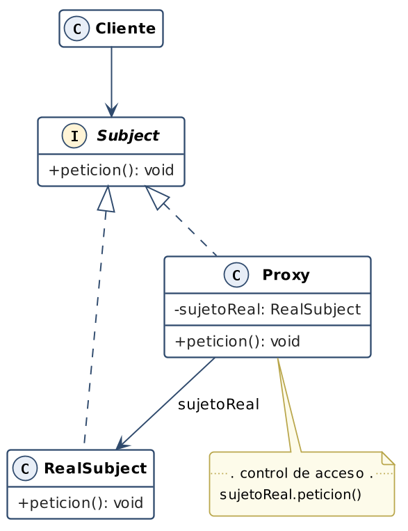
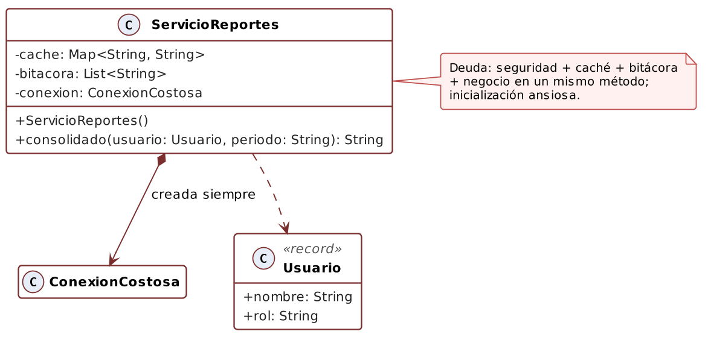
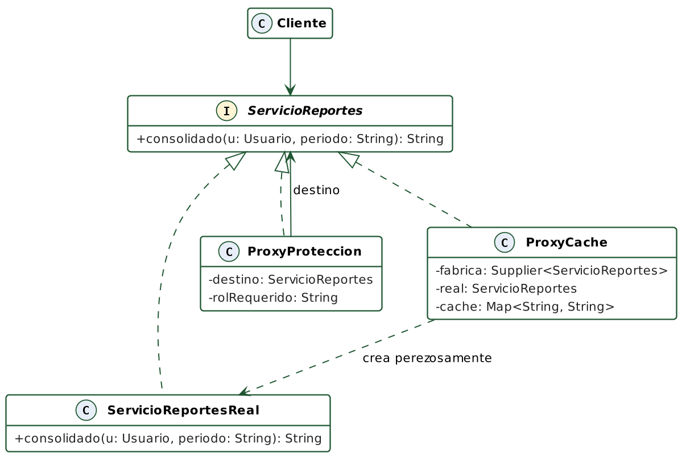

# 12. Proxy (Apoderado)

**Categoría:** Estructural · **Ámbito:** Objeto · **También conocido como:** Surrogate, Sustituto, Apoderado

> **Intención.** Proporcionar un sustituto o representante de otro objeto para controlar el acceso a él.

## Estructura genérica



## 1. Problema: código con deuda técnica (`problema/`)

ServicioReportes valida permisos, administra una caché y registra el acceso dentro del mismo método que genera el reporte. El objeto costoso se crea aunque nunca se use.



**Deuda técnica identificada:**

- Preocupaciones transversales (seguridad, caché, registro) mezcladas con la lógica de negocio: viola SRP.
- Inicialización ansiosa de un recurso costoso aunque no se use.
- Imposible reutilizar la caché o el control de acceso en otros servicios sin copiar código.
- Las pruebas de la lógica de negocio requieren preparar usuarios y estado de caché.

## 2. Solución refactorizada con el patrón (`solucion/`)

ServicioReportes pasa a ser una interfaz. ServicioReportesReal contiene solo la lógica de negocio. ProxyProteccion valida el rol y ProxyCache crea el servicio real de forma perezosa y reutiliza los resultados. Los proxies se encadenan sin que el cliente lo note.



## 3. Ejemplos adicionales (`ejemplos/`)

| Paquete | Ejemplo | Descripción |
|---|---|---|
| `ejemplos/virtual` | Proxy virtual para imágenes | Las imágenes de alta resolución se cargan solo cuando se muestran. |
| `ejemplos/dinamico` | Proxy dinámico con java.lang.reflect.Proxy | Registro de tiempos para cualquier interfaz sin escribir una clase proxy. |

## Cómo ejecutar

```bash
scripts/ejecutar.sh proxy            # todas las demos de este patrón
java -cp target/classes edu.ingsoft.gof.estructurales.proxy.problema.Demo
java -cp target/classes edu.ingsoft.gof.estructurales.proxy.solucion.Demo
```

## Salida esperada de la solución

```text
Instancias reales antes de usar: 0
Ingresos 2026-10: $1.250M | Gastos: $980M
Acceso denegado a Juan
Instancias reales: 1 | consultas reales: 1
```

## Preguntas de estudio

1. ¿Por qué Spring no puede aplicar @Transactional a una llamada interna dentro del mismo bean (auto-invocación)?
2. Compare un proxy dinámico de JDK con uno basado en CGLIB/ByteBuddy. ¿Qué limitaciones tiene cada uno?
3. ¿Cómo invalidaría la caché del proxy cuando cambian los datos de origen?

[← Volver al índice](../../../../../../../../README.md)
